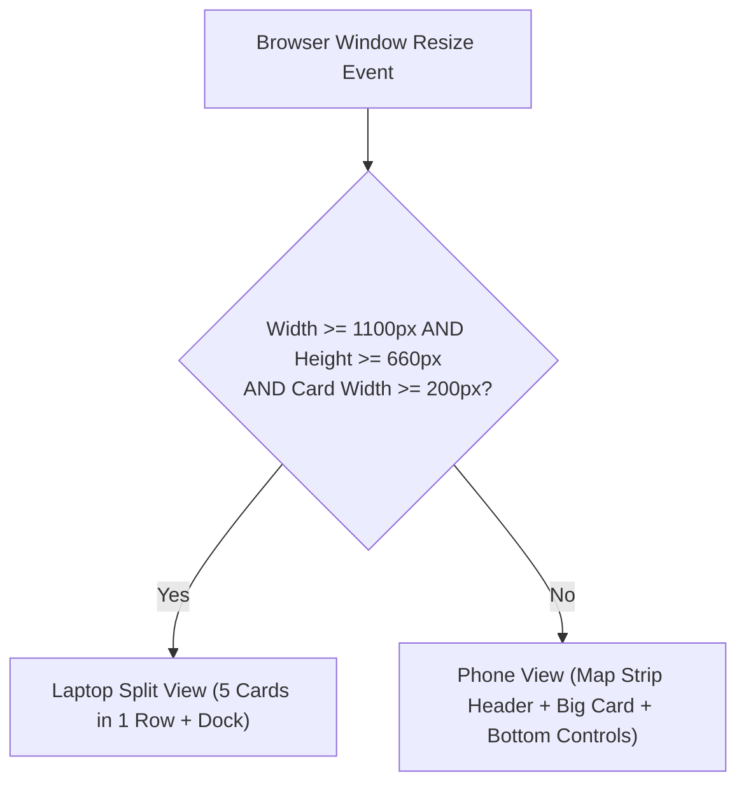
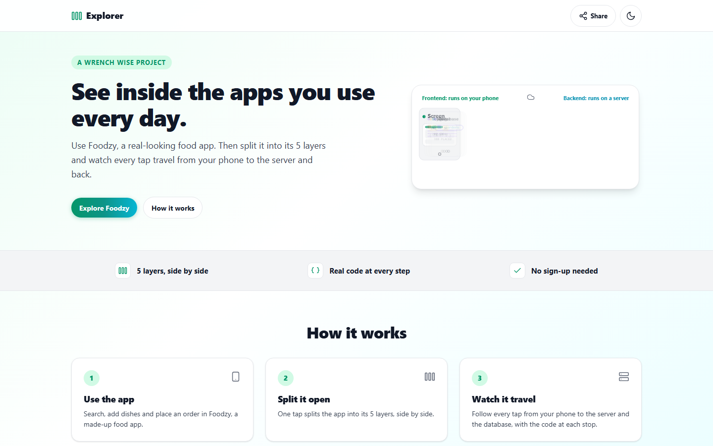
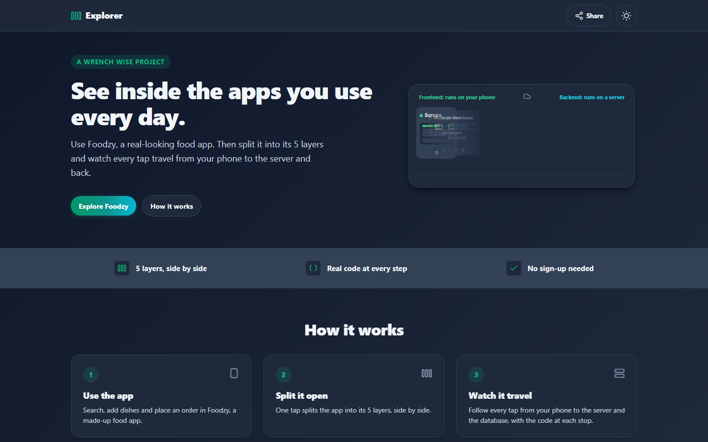
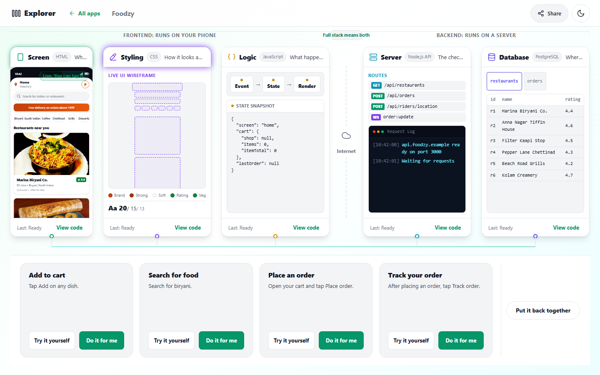
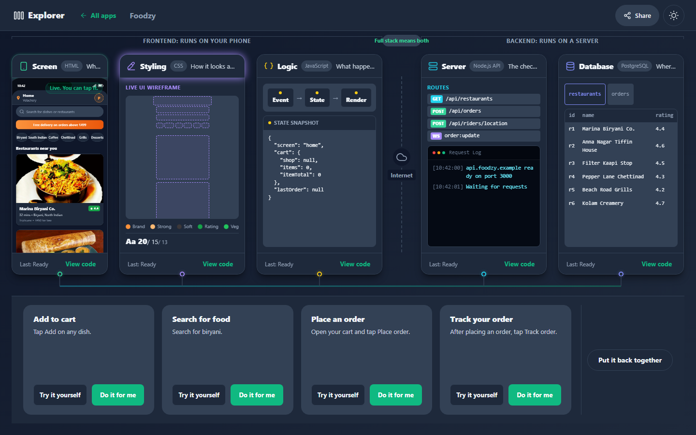
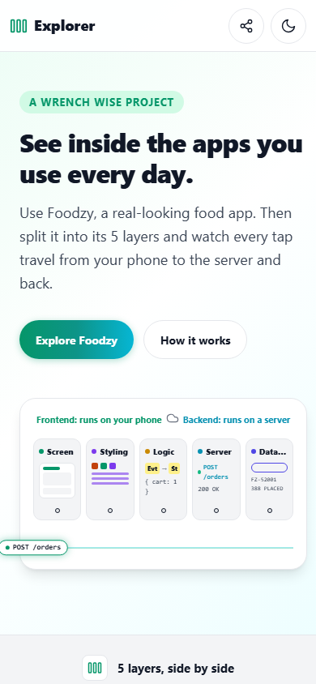
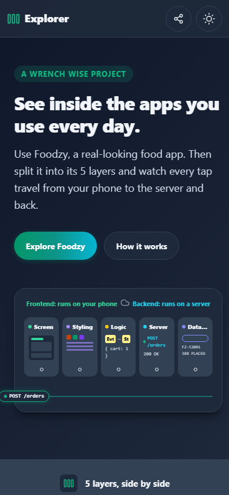
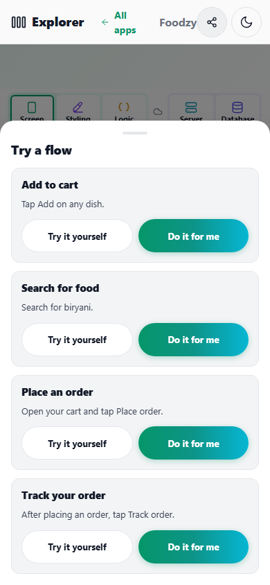
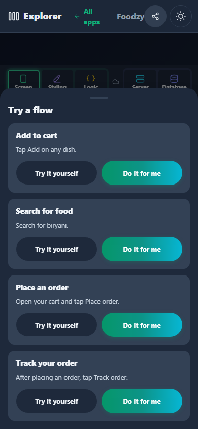
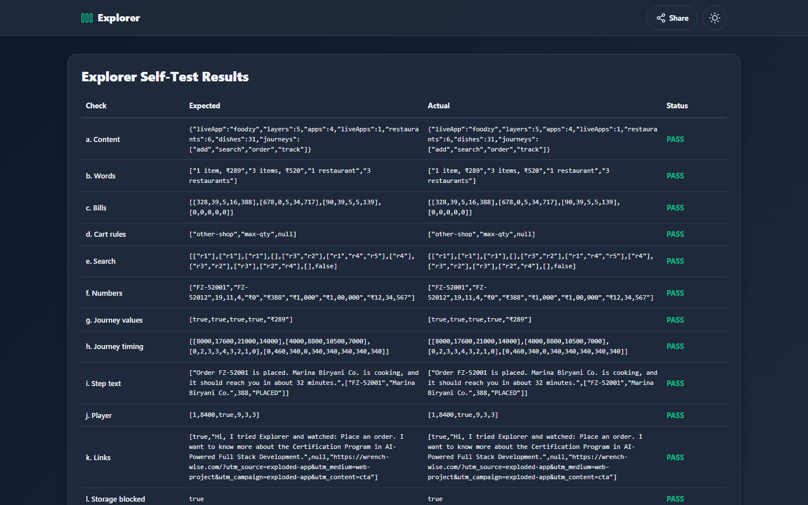

# Explorer: Complete Project Details

This document explains every detail of the Explorer project. It is written in plain English with short sentences. Anyone who has never seen this project can use this document to understand, use, explain, test, deploy, and rebuild it.

---

## Table of Contents

1. [Quick Summary](#1-quick-summary)
2. [Purpose](#2-purpose)
3. [How to Open It](#3-how-to-open-it)
4. [Every Screen and Every Feature](#4-every-screen-and-every-feature)
5. [Every Control](#5-every-control)
6. [One Full Journey](#6-one-full-journey)
7. [The Logic](#7-the-logic)
8. [The Data](#8-the-data)
9. [Every File](#9-every-file)
10. [Tech Used](#10-tech-used)
11. [Design](#11-design)
12. [Motion and Interactions](#12-motion-and-interactions)
13. [Words on Screen](#13-words-on-screen)
14. [Settings and Saved Data](#14-settings-and-saved-data)
15. [Testing](#15-testing)
16. [Deployment](#16-deployment)
17. [Honest Status](#17-honest-status)
18. [Rebuild Guide](#18-rebuild-guide)
19. [Learning Value](#19-learning-value)
20. [Showcase](#20-showcase)
21. [Glossary](#21-glossary)

---

## 1. Quick Summary

Explorer is an interactive learning website that shows how modern phone and web applications work behind the scenes. Visitors try out a realistic food ordering app named Foodzy, tap one button to split the app into its 5 full stack layers side by side, and watch animated data packets travel from the phone screen to the database server and back (index.html, js/main.js, js/ui/split.js). A full stack layer is one distinct tier of software engineering, starting from the buttons you tap on your glass screen down to the permanent data tables stored on cloud hard drives.

### Project Fact Table

| Metric | Project Value | Location in Code |
| :--- | :--- | :--- |
| Project Name | Explorer | (config.js, line 6; index.html, line 6) |
| Current Version | 2.0.0 | (config.js, line 6; content/index.js, line 11) |
| Total Project Files | 130 files (121 core project files plus 9 documentation screenshots) | (Project root directory) |
| Total Lines of Code | 19,103 lines across JavaScript, CSS, HTML, JSON, and MJS | (js/, styles/, content/, tools/) |
| Total Text and Doc Lines | 21,038 lines including Markdown guides and photo credits | (README.md, briefs, assets/food/) |
| Git Repository | https://github.com/Pradeep-B28/Explorer.git | (.git/config) |
| Active Git Branches | master (production tracking) and upgrade-explorer (v2.0.0 feature branch) | (git branch) |
| Latest Git Commit | fdfb4a8 (dated 2026-11-02) | (git log -1) |
| Production Live URL | https://explorer-mu-nine.vercel.app | (config.js, line 9; index.html, line 15) |
| Educational Partner | Wrench Wise Edutech Private Limited | (index.html, lines 63 to 69; README.md) |
| Connected Course | Certification Program in AI-Powered Full Stack Development | (config.js, line 18) |
| Registered Applications | 4 apps (1 live application: Foodzy; 3 preview applications: Mpay, Chitchat, Tripz) | (content/apps.js, lines 5 to 34) |
| Architecture Layers | 5 layers: Screen (HTML), Styling (CSS), Logic (JavaScript), Server (Node.js API), Database (PostgreSQL) | (content/layers.js, lines 5 to 41) |
| Partner Restaurants | 6 Chennai-themed restaurants | (content/apps/foodzy/restaurants.js, lines 5 to 115) |
| Food Dishes on Menu | 31 distinct dishes across 6 restaurants | (content/apps/foodzy/restaurants.js) |
| Realistic Food Photos | 37 photos (6 restaurant shop fronts and 31 dish photos) | (assets/food/shops/, assets/food/dishes/) |
| Interactive Journeys | 4 production flows: Add to cart, Search for food, Place an order, Track your order | (content/apps/foodzy/journeys.js, lines 5 to 645) |
| Automated Self-Tests | 17 comprehensive in-browser tests (checks a to q) | (js/selftest.js, lines 69 to 377) |
| Headless Engine Checks | 2,044 automated assertions | (tools/verify-content.mjs, lines 80 to 424) |
| External Dependencies | 0 runtime dependencies, 0 npm packages, 0 web fonts, 0 CSS frameworks | (package.json absent, native ES modules) |

---

## 2. Purpose

### The Problem It Solves

When students and career changers start learning web development, they often see frontend and backend as two completely separate worlds. Frontend means the code that runs on a user's phone or laptop browser. Backend means the code that runs on remote computers in data centers. Beginners frequently memorize syntax without understanding what actually happens when they tap a button like "Place order". They do not know where their request goes, why the server recalculates the prices, or how a database permanently writes rows to disk.

Existing architecture diagrams are usually flat boxes, static slides, or complex network flowcharts with arrows. Those diagrams are hard to follow. They do not show real code side by side with the real screen.

Explorer solves this problem by turning abstract concepts into an interactive visual machine:
1. It presents a real, working food delivery app named Foodzy that anyone knows how to use (js/apps/foodzy/index.js).
2. It lets the visitor split the phone open into 5 physical cards placed side by side on one horizontal table (js/ui/split.js).
3. It sends a glowing data packet across the wire connecting the cards so the visitor can follow their tap step by step (js/ui/packet.js, js/player.js).
4. At every single stop, it shows the exact file name and the exact lines of code that handle that step (content/apps/foodzy/journeys.js).

### Who It Is For

1. **Prospective Students**: People who are thinking about learning full stack software engineering. Many have never written a line of code. They need to see the big picture before diving into complex syntax.
2. **Social Media Audiences**: Mobile visitors who find Wrench Wise through video reels on Instagram or YouTube. They can watch autonomous recordings that explain full stack concepts in 30 seconds (REEL_SCRIPT.md).
3. **Classroom and Webinar Attendees**: Instructors who teach live online workshops on Zoom or Google Meet. Instructors can turn on Presenter Mode with large text and keyboard shortcuts to walk through live flows (js/demo.js, initPresenterMode).
4. **Admissions and Career Counselors**: Educational counselors who talk to students on WhatsApp. They can share direct links so students can explore the architecture themselves without creating an account or paying any money (js/links.js, getWhatsAppLink).

### Why It Was Built

Explorer was designed and built by B Pradeep in collaboration with Wrench Wise Edutech Private Limited (README.md, index.html). It was built as a zero-barrier educational showcase. It requires no login, no password, no payment, and no software installation. It runs completely inside any standard mobile or desktop web browser.

### Connected Program

Explorer directly connects to the **Certification Program in AI-Powered Full Stack Development** offered by Wrench Wise (config.js, line 18).

Throughout the application, the educational message remains consistent: "This is what a full stack developer builds. In the Certification Program in AI-Powered Full Stack Development, you build every layer yourself" (js/copy.js, lines 83 to 85; js/ui/cta.js). Tapping the WhatsApp button opens a prefilled chat with the Wrench Wise admissions team at phone number `917550077725`, listing the exact flows the visitor watched (config.js, lines 12 to 14; js/links.js).

---

## 3. How to Open It

### The Live Link

The application is deployed live on the web at:
[https://explorer-mu-nine.vercel.app](https://explorer-mu-nine.vercel.app) (config.js, line 9; README.md, line 3).

### How to Run It on a Laptop Step by Step

Explorer is built with native web standards. It has zero build steps, zero compilation, and zero npm packages to install. Because it uses modern JavaScript ES modules (ECMAScript modules, which are files that use `import` and `export` statements), web browsers require files to be served through a local HTTP web server rather than opened as raw `file:///` paths.

Follow these 4 numbered steps to run the project locally:

1. Open your terminal or command prompt (such as PowerShell on Windows, or Terminal on macOS).
2. Change directory into the project folder:
   ```bash
   cd "C:\Projects\Wrench-Wise\7 Explorer"
   ```
3. Start a local static file server using Node.js:
   ```bash
   npx --yes serve .
   ```
   Or use Python if you prefer:
   ```bash
   python -m http.server 3000
   ```
4. Open your web browser (Google Chrome, Microsoft Edge, Mozilla Firefox, or Apple Safari) and navigate to:
   ```
   http://localhost:3000
   ```

### Every Special Link Option

Explorer includes URL query parameters and hash routes that change how the app behaves. The table below lists every option found in the code:

| URL Option | Example Link | What It Does | Where It Lives |
| :--- | :--- | :--- | :--- |
| Product Home Route | `#/` | Opens the main marketing product page with hero preview loop, facts strip, 3-step explanation, layer overview, app picker, and footer. | (js/router.js, getRoute; js/screens/home.js) |
| Foodzy Stage Route | `#/app/foodzy` | Opens the interactive Foodzy stage screen with the virtual phone and "Show me how it works" split trigger. | (js/router.js; js/screens/stage.js) |
| Legacy Thattu Route | `#/app/thattu` | Automatically redirects to `#/app/foodzy` without breaking older bookmarks or links. | (js/router.js, lines 27 to 30) |
| Self-Test Suite | `?test=1` | Bypasses the application and runs 17 automated checks (a to q) in the browser. It displays a complete PASS/FAIL report table on screen. No analytics are loaded and no storage is written. | (index.html, lines 131 to 135; js/selftest.js) |
| Autonomous Demo Mode | `?demo=1` | Runs an automated, deterministic demo recording sequence for social media reels. It hides normal controls, sets up demo data, splits the app, and plays flows automatically. | (js/demo.js, initDemoMode; js/main.js, lines 66 to 71) |
| Demo Flow Selector | `?demo=1&flow=order` | Specifies which journey to run during demo mode (`add`, `search`, `order`, `track`, comma-separated list, or `all`). | (js/demo.js, lines 52 to 60) |
| Demo Playback Speed | `?demo=1&speed=2` | Overrides the playback clock speed during demo mode (options: `0.5`, `1`, `2`). | (js/demo.js, lines 107 to 133) |
| Presenter Mode | `?present=1` | Formats typography to 18px and larger for classroom projectors and Zoom webinars. Enables keyboard number shortcuts 1 to 4 to trigger flows, Space to pause, and question mark to view shortcut help. | (js/demo.js, initPresenterMode; config.js, line 49) |
| Forced Dark Theme | `?theme=dark` | Overrides system preferences and forces the dark color theme on page load. | (index.html, lines 116 to 121; js/demo.js, lines 47 to 49) |
| Forced Light Theme | `?theme=light` | Overrides system preferences and forces the light color theme on page load. | (index.html, lines 116 to 121) |


---

## 4. Every Screen and Every Feature

Explorer consists of two primary application views: the **Product Home Page** (`#/`) and the **Foodzy Stage** (`#/app/foodzy`). In addition, the Stage presents different interface layouts on laptop displays compared to mobile phone screens.

### 4.1 The Product Home Page (`#/`)

The Product Home Page introduces the concept of 5-layer software architecture and allows visitors to launch the interactive application.

#### What It Does
1. Welcomes visitors with an animated headline and value proposition (js/screens/home.js, lines 36 to 47).
2. Runs an automated 8-second looping animation in the hero section. A small phone splits into 5 cards side by side, a packet dot travels back and forth along the bus wire, and the cards assemble back together into a phone (js/screens/home.js, lines 76 to 195). On laptop screens, the preview card tilts in 3D up to 4 degrees following the mouse pointer (js/screens/home.js, lines 490 to 522).
3. Displays a 3-item facts strip highlighting side-by-side layers, real code at every step, and zero required sign-ups (js/screens/home.js, lines 203 to 226).
4. Explains how the platform works through 3 numbered step cards: Use the app, Split it open, and Watch it travel (js/screens/home.js, lines 229 to 277).
5. Shows a complete architectural breakdown of the 5 full stack layers grouped under Frontend and Backend brackets (js/screens/home.js, lines 280 to 335).
6. Displays the 4-app picker grid featuring Foodzy as live and Mpay, Chitchat, and Tripz as coming soon (js/screens/home.js, lines 338 to 403).
7. Shows a full-width promotional banner for the Wrench Wise full stack certification program with direct WhatsApp and website links (js/screens/home.js, lines 405 to 445).

#### How to Use It in Click Steps
1. Open `http://localhost:3000/#/` in your browser.
2. Scroll through the page to read the layer breakdown and how data moves across the internet gap.
3. Click the primary button **"Explore Foodzy"** in the hero section or **"Open"** on the Foodzy app card to enter the interactive stage (js/screens/home.js, line 54 and line 386).

#### What the Person Sees
- **Top Header**: Fixed 64px header containing the Explorer logo wordmark, a Share button, and a sun or moon theme toggle button (index.html, lines 40 to 56).
- **Hero Left**: Eyebrow badge "A Wrench Wise project", 48px headline "See inside the apps you use every day", description paragraph, and two rounded pill buttons: "Explore Foodzy" and "How it works" (js/screens/home.js, lines 36 to 74).
- **Hero Right**: A clean 3D preview card showcasing miniature floating cards and a moving data packet (js/screens/home.js, lines 76 to 195).
- **Facts Strip**: 3 horizontal items with custom SVG vector icons (SVG means Scalable Vector Graphics, which are images drawn with mathematical lines that never get blurry): "5 layers, side by side", "Real code at every step", and "No sign-up needed" (js/screens/home.js, lines 203 to 226).
- **How It Works**: 3 numbered white cards explaining the learning flow (js/screens/home.js, lines 229 to 277).
- **Frontend Plus Backend**: Visual brackets displaying Screen (HTML), Styling (CSS), and Logic (JavaScript) under "Frontend: runs on your phone", an Internet Gap cloud icon, and Server (Node.js API) and Database (PostgreSQL) under "Backend: runs on a server" (js/screens/home.js, lines 280 to 335).
- **App Picker**: 4 grid cards. Foodzy displays an orange bowl icon with an "Open" button. Mpay, Chitchat, and Tripz display wallet, chat, and bus icons with greyed-out "Coming soon" chips (js/screens/home.js, lines 338 to 403).
- **Program Band**: An emerald-tinted callout band with buttons for "Talk to us on WhatsApp" and "See the program" (js/screens/home.js, lines 405 to 445).
- **Footer**: Three plain text lines stating the site is built by Wrench Wise, disclaiming that Foodzy, Mpay, Chitchat, and Tripz are made-up apps for learning, and displaying the copyright (index.html, lines 60 to 72).

---

### 4.2 The Foodzy Application Inside the Virtual Phone

The virtual phone simulates a modern smartphone screen rendered at 360 x 760 pixels with a status bar showing the time 10:42, cellular signal bars, and a battery icon (js/ui/phone.js, lines 26 to 63). It contains 5 sub-screens:

#### Screen 1: Foodzy Home (`home`)
- **What It Does**: Displays the delivery address, search bar, offer banner, cuisine categories, and restaurant listing (js/apps/foodzy/screens/home.js).
- **How to Use It**:
  1. Tap any category chip (such as "Biryani" or "Coffee") to instantly filter restaurants matching that category (js/apps/foodzy/screens/home.js, lines 174 to 189).
  2. Type letters into the search input box. Keystrokes are debounced by 300 milliseconds (debounced means the app waits for a 300 millisecond pause in typing before running the search function to save computer effort) (js/apps/foodzy/screens/home.js, lines 123 to 139).
  3. Tap any restaurant card to open its full menu (js/apps/foodzy/screens/home.js, lines 230 to 248).
- **What You See**: Location row ("Home, Velachery") with an avatar circle, search input field with magnifying glass icon, orange offer banner ("Free delivery on orders above ₹499"), 6 category chips, and a scrollable list of 6 restaurant cards with realistic photos, star ratings, delivery times, and price for two (js/apps/foodzy/screens/home.js).

#### Screen 2: Restaurant Menu (`restaurant`)
- **What It Does**: Shows restaurant information, cuisine type, address area, rating, free delivery threshold, and the menu of available dishes (js/apps/foodzy/screens/restaurant.js).
- **How to Use It**:
  1. Browse through the dishes.
  2. Tap the green or red **"ADD"** button next to any dish (js/apps/foodzy/ui/dish.js, lines 112 to 123).
  3. Once added, the button converts into a quantity stepper with minus (`-`), count, and plus (`+`) buttons (js/apps/foodzy/ui/dish.js, lines 78 to 111).
  4. Notice the floating cart bar slide up from the bottom of the phone displaying the total items and rupee total (js/apps/foodzy/ui/cartbar.js).
  5. Tap **"View cart"** on the floating bar to open the checkout screen (js/apps/foodzy/ui/cartbar.js, lines 30 to 35).
- **What You See**: Top back button with restaurant name, rating chip (e.g. 4.4 with star), cuisine text, offer strip, dish items with veg green square or non-veg red triangle badges, bold dish names, rupee prices, descriptions, square food photos, and the floating bottom cart bar (js/apps/foodzy/screens/restaurant.js).

#### Screen 3: Cart Checkout (`cart`)
- **What It Does**: Reviews selected dishes, calculates item total, delivery fee, platform fee, GST (Goods and Services Tax), and grand total, and allows the visitor to place the order (js/apps/foodzy/screens/cart.js).
- **How to Use It**:
  1. Increase or decrease dish quantities using the stepper buttons (js/apps/foodzy/screens/cart.js, lines 118 to 143).
  2. If all items are removed, the screen displays an empty cart message with a "Browse restaurants" button (js/apps/foodzy/screens/cart.js, lines 67 to 86).
  3. Review the itemized bill details.
  4. Tap the full-width green **"Place order"** button in the footer (js/apps/foodzy/screens/cart.js, lines 247 to 270).
- **What You See**: Selected restaurant name and area, list of ordered dishes with unit prices and steppers, bill breakdown card showing Item total, Delivery fee (showing "FREE" with strikethrough if order is ₹499 or more), Platform fee (₹5), GST and restaurant charges (5%), and grand total To pay (js/apps/foodzy/screens/cart.js, lines 157 to 205). Below sits the delivery address card, payment method indicator ("Pay with UPI"), and sticky checkout footer (js/apps/foodzy/screens/cart.js, lines 207 to 274).

#### Screen 4: Order Confirmation (`placed`)
- **What It Does**: Confirms that the order has been received and assigned an order number (js/apps/foodzy/screens/placed.js).
- **How to Use It**:
  1. Tap **"Track order"** to watch live delivery tracking (js/apps/foodzy/screens/placed.js, lines 61 to 81).
  2. Or tap **"Back to home"** to return to the restaurant listing (js/apps/foodzy/screens/placed.js, lines 83 to 89).
- **What You See**: An animated green checkmark circle with checkmark drawing animation, "Order placed" header, generated order number (e.g. `FZ-52001`), kitchen preparation message, arrival estimate (e.g. "Arriving in 32 mins"), and two action buttons (js/apps/foodzy/screens/placed.js, lines 30 to 95).

#### Screen 5: Live Order Tracking (`track`)
- **What It Does**: Renders an interactive vector road map with restaurant pin, home pin, delivery path route, and an animated rider icon moving along the path (js/apps/foodzy/screens/track.js; js/apps/foodzy/ui/map.js).
- **How to Use It**:
  1. View the delivery rider moving smoothly along the road.
  2. An order lookup text field at the top allows looking up any valid order number (js/apps/foodzy/screens/track.js, lines 56 to 100).
  3. Tap the telephone icon button to test calling the delivery partner (displays a polite demo notice) (js/apps/foodzy/screens/track.js, lines 200 to 208).
- **What You See**: Top navigation with back button, order lookup input card, drawn SVG map displaying light tan land, white road curves, orange restaurant pin "R", green home pin, dashed route curve, and rider marker circle (js/apps/foodzy/ui/map.js). Below the map sits the order number, restaurant name, "On the way" status pill, minutes remaining, a 4-step progress line (Placed, Preparing, On the way, Delivered), and delivery rider Arun's card with call button (js/apps/foodzy/screens/track.js, lines 106 to 213).

---

### 4.3 Laptop Layout vs Phone Layout

Explorer automatically measures the browser window dimensions and switches between two distinct user interfaces using the pure layout function `layoutFor(width, height)` (js/engine/layout.js, lines 44 to 47):



#### Laptop Layout (Width >= 1100px, Height >= 660px, Card Width >= 200px)

```
===================================================================================================
 Explorer                                                                           [Share] [Theme]
---------------------------------------------------------------------------------------------------
   [---------- FRONTEND (Runs on phone) ----------]    (Cloud)    [---- BACKEND (Runs on server) -]
   +-----------+ +-----------+ +-----------+       . . . . .      +-----------+ +-----------+
   |  SCREEN   | |  STYLING  | |   LOGIC   |       Internet       |  SERVER   | | DATABASE  |
   | Live App  | | Wireframe | | Event     |         Gap          | Routes    | | Orders    |
   | Phone     | | Swatches  | | > State   |                      | Logs      | | Table     |
   | 360 x 760 | | Type      | | > Render  |                      |           | |           |
   +-----o-----+ +-----o-----+ +-----o-----+                      +-----o-----+ +-----o-----+
=========*===========================*========[ packet: label ]=========*=============*============ Bus
---------------------------------------------------------------------------------------------------
 | Step 3 of 9: SERVER       | Tab: server/routes/orders.js (js)             | Packet Data JSON    |
 | The server checks         | 1  router.post('/api/orders', ...             | { 'loggedIn': true, |
 | everything                | 2    const { shopId, items } = req.body;      |   'total': 388 }    |
 | It works out the price... | 3    const bill = priceItems(items, menu);    | [Back] [Play] [Next]|
===================================================================================================
```

1. **Before Split (Flat Mode)**: The virtual phone sits slightly to the left of the center. To its right sits an intro panel with the headline "Want to see inside?", descriptions of the 5 layers, and the wide primary button **"Show me how it works"** (js/ui/split.js, lines 73 to 138).
2. **The Split Animation**: When the user taps "Show me how it works", the intro panel fades out. The phone shrinks to its exact scaled slot inside the Screen card. The other 4 cards (Styling, Logic, Server, Database) slide out horizontally using a FLIP animation technique (FLIP stands for First, Last, Invert, Play, which calculates start and end positions to create silky smooth transitions without lag) (js/ui/split.js, lines 400 to 480).
3. **The 5-Card Row**: All 5 cards sit in one horizontal plane. Group brackets identify Frontend and Backend. An 80px Internet Gap with a cloud icon separates Logic from Server (js/ui/split.js, lines 150 to 200).
4. **The Bus Line and Packet**: A glowing horizontal wire runs 24px below all cards. Each card has a 10px port circle at the bottom. When a step executes, a 30px pill-shaped luminous packet travels down from the source port, across the bus wire, and up into the destination port (js/ui/split.js, lines 230 to 300).
5. **The Dock**: A full-width control center anchored below the bus wire. It operates in 3 distinct modes:
   - **Flow List Mode**: Displays 4 flow cards with "Try it yourself" and "Do it for me" buttons, plus a "Put it back together" button (js/ui/split.js, lines 800 to 890).
   - **Playback Mode**: Divided into 3 columns:
     - Left column (280px): Step count, layer badge, step title, and plain English explanation (js/ui/split.js, lines 950 to 1000).
     - Middle column: 5 layer tabs displaying file paths (e.g. `server/routes/orders.js`), language tags, a "Copy code" button, and auto-typing code with line numbers (js/ui/split.js, lines 1020 to 1150).
     - Right column (260px): Formatted packet JSON data and playback controls (Back, Play/Pause, Next, Replay, Close, and Speed control) (js/ui/split.js, lines 1160 to 1240).
   - **Flow End Mode**: Displays the engineering lesson, the Wrench Wise certification program card with WhatsApp chat button, and buttons for "Try another flow", "See the full stack code", and "Share" (js/ui/split.js, lines 1280 to 1350).

#### Phone Layout (Width < 1100px or Height < 660px)

```
================================================================
 Explorer                                        [Share] [Theme]
----------------------------------------------------------------
 [Scr] [Sty] [Log]      (Cloud)      [Srv] [DB]   <- Map Strip
 ========================*======================  <- Moving dot
----------------------------------------------------------------
  SERVER (Node.js API)                            <- Big Card
  POST /api/orders
  ----------------------------------------------
  [10:42:07] POST /api/orders checks passed
  ----------------------------------------------
  Step 3 of 9
  The server checks everything
  The server checks you are logged in and Marina
  Biryani Co. is open. It works out the price.
  ----------------------------------------------
  server/routes/orders.js                    [Copy]
   1  router.post('/api/orders', ...
   2    const { shopId, items } = req.body;
  ----------------------------------------------
  > What travels (tap to open JSON)
----------------------------------------------------------------
 [Back]         [Play / Pause]         [Next]      [1x / 2x]
================================================================
```

1. **Before Split (Flat Mode)**: The virtual phone fills the width of the mobile viewport, with a large "Show me how it works" button anchored directly below it (js/ui/phone-view.js, lines 87 to 103).
2. **The Split Animation**: The phone shrinks upward into the Screen tile inside the top map strip (500 milliseconds), while the other 4 tiles slide out horizontally from behind it (60 milliseconds apart). The Big Card fades in directly below (js/ui/phone-view.js, lines 240 to 300).
3. **The Map Strip**: A sticky 96px header at the top of the mobile screen. It displays 5 small tiles representing the 5 layers, frontend and backend background tints, the cloud icon gap, and a thin bus wire with a glowing 12px packet dot moving in real time (js/ui/phone-view.js, lines 105 to 200). Tapping any tile manually switches the Big Card to inspect that layer (js/ui/phone-view.js, lines 185 to 195).
4. **The Big Card**: Full-width active layer card located below the map strip. It displays the live work of that layer:
   - When Screen is active: The real, interactive Foodzy phone (js/ui/phone-view.js, lines 340 to 360).
   - When Styling is active: The live wireframe, color swatches, and typography samples (js/ui/layers/styling.js).
   - When Logic is active: Event, State, and Render nodes with flashing state JSON (js/ui/layers/logic.js).
   - When Server is active: Route list and dark terminal log (js/ui/layers/server.js).
   - When Database is active: SQL tables with row highlights (js/ui/layers/database.js).
   - Underneath the visual work: Step counter, step heading, plain English explanation, auto-wrapping code with hanging line numbers that never cause sideways scrolling, and an accordion for packet data JSON (js/ui/phone-view.js, lines 380 to 480).
5. **Sticky Mobile Controls**: Large 48px touch targets anchored firmly to the bottom edge of the phone display, containing Back, Play/Pause, Next, and Speed toggle buttons (js/ui/phone-view.js, lines 520 to 600).
6. **Mobile Flow Sheets**: The flow selection list and completion CTA open as full-screen modal sheets that slide up smoothly from the bottom edge (js/ui/phone-view.js, lines 620 to 780).

---

## 5. Every Control

The table below lists every interactive button, input field, tab, toggle, and keyboard shortcut across the entire Explorer application.

| Control Label | Type | Location on Screen | What It Does | Where It Lives in Code |
| :--- | :--- | :--- | :--- | :--- |
| **Site Logo Wordmark** | Link | Top header left | Navigates back to the product home page (`#/`). | (index.html, lines 42 to 45; js/screens/stage.js, lines 38 to 44) |
| **Share** | Button | Top header right | Opens the native Web Share API dialog on mobile, or copies the site share URL with UTM parameters to the clipboard on laptop. | (index.html, lines 47 to 50; js/ui/share.js, lines 24 to 61) |
| **Theme Toggle** | Button | Top header right | Switches between light and dark visual themes and saves preference in `localStorage` under `tea-theme`. | (index.html, lines 51 to 53; js/screens/stage.js, lines 68 to 92) |
| **Explore Foodzy / Open** | Link | Home page hero and app picker | Navigates into the Foodzy interactive stage (`#/app/foodzy`). | (js/screens/home.js, line 54 and line 386) |
| **How it works** | Button | Home page hero | Smoothly scrolls the page down to the 3-step explanation section. | (js/screens/home.js, lines 56 to 65) |
| **All apps** | Link | Stage header left | Navigates out of the stage back to the home page (`#/`). | (js/screens/stage.js, lines 46 to 52) |
| **Show me how it works** | Button | Below flat phone on stage | Triggers the FLIP animation that splits the phone into the 5 full stack layers. | (js/ui/split.js, lines 112 to 134; js/ui/phone-view.js, lines 95 to 101) |
| **Put it back together** | Button | Dock right (laptop) or stage top | Reverses the split animation, reassembles the phone, and closes any active flow. | (js/ui/split.js, lines 870 to 885) |
| **Category Chips** | Buttons | Foodzy home screen below search | Filters the restaurant list by cuisine keyword (e.g. Biryani, Coffee). | (js/apps/foodzy/screens/home.js, lines 174 to 189) |
| **Search Input** | Text Input | Foodzy home screen | Accepts search terms. Debounces input by 300ms to filter restaurants and dishes live. | (js/apps/foodzy/screens/home.js, lines 86 to 147) |
| **Search Clear (`×`)** | Button | Inside search input box | Clears the typed search query and restores the full restaurant list. | (js/apps/foodzy/screens/home.js, lines 92 to 101, 155 to 160) |
| **User Avatar Circle** | Button | Foodzy home top right | Demo profile placeholder. Clicking displays a polite toast notice. | (js/apps/foodzy/screens/home.js, lines 62 to 69) |
| **Offer Banner** | Button | Foodzy home center | Promotional callout. Clicking displays a polite toast notice. | (js/apps/foodzy/screens/home.js, lines 163 to 172) |
| **Restaurant Card** | Card / Button | Foodzy home restaurant list | Opens that restaurant's full menu screen. | (js/apps/foodzy/ui/card.js, lines 24 to 38) |
| **Restaurant Back (`←`)** | Button | Restaurant screen header left | Navigates back from menu to the restaurant listing. | (js/apps/foodzy/screens/restaurant.js, lines 49 to 55) |
| **ADD** | Button | Next to each dish on menu | Adds 1 unit of that dish to the cart and reveals quantity stepper. | (js/apps/foodzy/ui/dish.js, lines 112 to 123) |
| **Dish Stepper (`-` / `+`)** | Buttons | Next to dish or in cart | Decreases or increases the quantity of that dish in the cart. | (js/apps/foodzy/ui/dish.js, lines 78 to 110) |
| **View cart** | Button | Floating bottom cart bar | Slides open the cart checkout screen. | (js/apps/foodzy/ui/cartbar.js, lines 30 to 35) |
| **Browse restaurants** | Button | Empty cart screen center | Navigates back to the home restaurant list when cart has no items. | (js/apps/foodzy/screens/cart.js, lines 76 to 82) |
| **Place order** | Button | Cart checkout footer | Submits the order, triggers the 9-step Place Order flow, or navigates to order confirmation. | (js/apps/foodzy/screens/cart.js, lines 247 to 270) |
| **Keep my cart** | Button | New cart modal dialog | Cancels adding a dish from a different restaurant, preserving current cart items. | (js/ui/dialog.js, lines 44 to 52) |
| **Start new cart** | Button | New cart modal dialog | Clears current cart and starts a fresh cart with the selected dish. | (js/ui/dialog.js, lines 53 to 61) |
| **Track order** | Button | Order placed screen | Navigates to the real-time delivery map tracking screen. | (js/apps/foodzy/screens/placed.js, lines 61 to 81) |
| **Back to home** | Button | Order placed or tracking screen | Navigates back to the Foodzy home restaurant list. | (js/apps/foodzy/screens/placed.js, lines 83 to 89; js/apps/foodzy/screens/track.js, lines 41 to 46) |
| **Order Lookup Input** | Text Input | Live tracking screen top | Allows entering an order ID to simulate looking up delivery status. | (js/apps/foodzy/screens/track.js, lines 81 to 88) |
| **Rider Call Button** | Button | Rider info card | Demo call trigger. Clicking displays a polite toast notice. | (js/apps/foodzy/screens/track.js, lines 200 to 208) |
| **Try it yourself** | Button | Dock flow cards / mobile sheet | Enters guided mode. Brings the phone to center and displays an instruction hint banner. | (js/ui/split.js, lines 835 to 855; js/ui/phone-view.js, lines 660 to 675) |
| **Do it for me** | Button | Dock flow cards / mobile sheet | Automatically prepares required state (e.g. populates cart) and clicks the action. | (js/ui/split.js, lines 856 to 868; js/apps/foodzy/index.js, lines 103 to 156) |
| **Try It Cancel** | Button | Banner above phone | Exits guided "Try it yourself" mode and restores the normal split view. | (js/ui/split.js, lines 1420 to 1450) |
| **Back (`←`)** | Button | Dock playback right / phone bar | Steps backward to the previous step in the active flow (never undoes commit). | (js/ui/split.js, lines 1175 to 1185; js/player.js, lines 181 to 186) |
| **Play / Pause** | Button | Dock playback right / phone bar | Pauses or resumes animated step playback and packet travel. | (js/ui/split.js, lines 1186 to 1200; js/player.js, lines 126 to 163) |
| **Next (`→`)** | Button | Dock playback right / phone bar | Advances immediately to the next step in the active flow. | (js/ui/split.js, lines 1201 to 1210; js/player.js, lines 165 to 179) |
| **Replay (`↺`)** | Button | Dock playback right | Restarts the current flow from step 1. | (js/ui/split.js, lines 1211 to 1218; js/player.js, lines 215 to 217) |
| **Close (`×`)** | Button | Dock playback right | Closes the active flow and returns the dock to the flow selection list. | (js/ui/split.js, lines 1219 to 1225; js/player.js, lines 219 to 226) |
| **Speed (0.5x, 1x, 2x)**| Segmented Button | Dock playback right / phone bar | Changes playback speed multiplier (half speed, normal, or double speed). | (js/ui/split.js, lines 1226 to 1245; js/player.js, lines 188 to 213) |
| **Layer Code Tabs** | Tabs (5) | Dock middle column | Switches between the 5 layers (Screen, Styling, Logic, Server, Database) to view latest code. Tabs remain disabled until that layer is reached. | (js/ui/split.js, lines 1030 to 1090) |
| **Copy code** | Button | Dock code header / all-code sheet | Copies the currently displayed snippet of code to the system clipboard. | (js/ui/split.js, lines 1095 to 1115; js/ui/allcode.js, lines 116 to 130) |
| **Database Tabs** | Tabs (2) | Database card top | Toggles between `restaurants` and `orders` SQL database tables. | (js/ui/layers/database.js, lines 26 to 39) |
| **See full stack code** | Button | Flow end card / mobile sheet | Opens the full-screen modal sheet displaying all code lines across all 5 layers. | (js/ui/split.js, lines 1320 to 1335; js/ui/allcode.js) |
| **Try another flow** | Button | Flow end card / mobile sheet | Returns to the flow selection list to choose another journey. | (js/ui/split.js, lines 1310 to 1318) |
| **Talk on WhatsApp** | Link / Button | Flow end card / home band | Opens WhatsApp with prefilled text listing watched flows and course name. | (js/ui/cta.js, lines 64 to 76; js/links.js, lines 43 to 54) |
| **See the program** | Link | Flow end card / home band | Opens the official Wrench Wise course page with UTM campaign tracking parameters. | (js/ui/cta.js, lines 77 to 86; js/links.js, lines 57 to 72) |
| **Spacebar** | Shortcut | Laptop keyboard | Toggles Play and Pause on the active journey player. | (js/demo.js, line 212; js/ui/split.js) |
| **Right Arrow (`→`)** | Shortcut | Laptop keyboard | Steps forward to the next step in the active journey. | (js/demo.js, line 213) |
| **Left Arrow (`←`)** | Shortcut | Laptop keyboard | Steps backward to the previous step in the active journey. | (js/demo.js, line 213) |
| **Escape (`Esc`)** | Shortcut | Laptop keyboard | Closes the active flow, closes modal sheets, or cancels guided turn mode. | (js/demo.js, line 214; js/ui/allcode.js, line 190) |
| **Keys 1, 2, 3, 4** | Shortcut | Laptop keyboard (`?present=1`) | In Presenter Mode, triggers flows 1 through 4 via "Do it for me". | (js/demo.js, lines 165 to 184) |
| **Question Mark (`?`)** | Shortcut | Laptop keyboard (`?present=1`) | In Presenter Mode, opens the keyboard shortcuts help dialog. | (js/demo.js, lines 180 to 184, 187 to 237) |


## 6. One Full Journey

This section walks through one complete, real journey from opening the application to the final delivered status. We use the flagship journey: **Place an order** (`order`), using real data from the app (content/apps/foodzy/journeys.js, lines 286 to 495).

### Phase 1: Exploring and Choosing Dishes

1. **Opening the App**:
   - **What happens on screen**: You open `http://localhost:3000/#/#` on a laptop screen (1440 by 900 pixels). The app boots, checks your saved theme preference, and renders the home stage with the Foodzy app in the Screen card. On the left, you see the Foodzy logo, the live address pill showing "Besant Nagar, Chennai", a search box, and six restaurant cards in a two-column grid.
   - **What happens in the code**: The browser executes `js/main.js`. It imports content from `content/index.js`, reads `tea-theme` from `localStorage`, mounts the router (`js/router.js`), and initializes the stage (`js/screens/stage.js`). The stage calls `layoutFor(1440, 900)` (js/engine/layout.js, lines 44 to 47), which returns `"laptop"`. It measures screen dimensions and renders the 5 split cards: Screen, Styling, Logic, Server, and Database (js/ui/split.js, lines 26 to 52).

2. **Selecting a Restaurant**:
   - **What happens on screen**: You click on the first restaurant card: **Marina Biryani Co.** (rating 4.4, eta 32 mins).
   - **What happens in the code**: The card anchor triggers a hash change to `#/r/r1` (js/router.js, lines 24 to 38). The Foodzy app controller renders the restaurant screen (`js/apps/foodzy/screens/restaurant.js`, lines 18 to 92). It displays the restaurant cover photo (`assets/food/r1.jpg`), address ("2nd Avenue, Besant Nagar"), safety badge ("FSSAI Lic. 12421008000432"), and its menu of 5 dishes.

3. **Adding Dishes to the Cart**:
   - **What happens on screen**: You scroll to "Chicken Dum Biryani" (₹289, non-veg) and click "+ ADD". The button flips into a quantity selector showing "− 1 +". At the bottom of the phone screen, a dark floating cart bar slides up saying "1 item, ₹289" with a green "View cart" button. Next, you scroll to "Onion Raita" (₹39, veg) and click "+ ADD". The cart bar updates to say "2 items, ₹328".
   - **What happens in the code**: The click event triggers `addItem(cart, restaurants, "r1i1")` (js/engine/foodzy/cart.js, lines 22 to 33). The pure function checks that the item belongs to Marina Biryani Co. (`r1`) and creates an updated cart object `{ shopId: "r1", lines: [{ itemId: "r1i1", qty: 1 }] }`. When the raita is added, `addItem` adds `{ itemId: "r1i5", qty: 1 }`. The cart bar controller (`js/apps/foodzy/ui/cartbar.js`, lines 14 to 42) formats the label using `itemTotal` (₹328), not the total bill.

4. **Opening the Cart**:
   - **What happens on screen**: You click "View cart" in the floating bar. The screen changes to the Cart screen (`#/cart`). You see your two dishes, a delivery address card, a bill breakdown showing Item total (₹328), Delivery fee (₹39), Platform fee (₹5), and Taxes and charges (₹16). The bottom checkout bar shows the final bill: "₹388" and a big green "Place order" button.
   - **What happens in the code**: The router loads `js/apps/foodzy/screens/cart.js`. It runs `bill(cart, restaurants, fees)` (js/engine/foodzy/cart.js, lines 72 to 84). It calculates:
     - `itemTotal`: (289 * 1) + (39 * 1) = 328
     - `freeDelivery`: 328 >= 499 is false, so delivery fee = ₹39
     - `platform`: ₹5
     - `gst`: Math.round(328 * 0.05) = Math.round(16.4) = ₹16
     - `total`: 328 + 39 + 5 + 16 = ₹388.

---

### Phase 2: Playing the Flagship Order Journey

When you tap "Place order" on the cart screen, the app recognizes the journey trigger (`on: "place-order"`) and initiates the 9-step animated explanation across all 5 architecture layers (js/player.js, lines 65 to 142).

```
[Screen] ---> [Logic] ---> [Server] ---> [Server] ---> [Database] ---> [Server] ---> [Logic] ---> [Styling] ---> [Screen]
Step 1        Step 2       Step 3        Step 4        Step 5          Step 6        Step 7       Step 8         Step 9
Tap order     Check &      Verify &      UPI collect   Save SQL        Kitchen       Save order   Slide up &     Order placed
              send JSON    re-price                    transaction     HTTP 201      & route      draw tick      summary
```

#### Step 1: You tap Place order (`order-1`, Layer: Screen, Duration: 1800 ms)
- **What happens on screen**: The Screen card highlights. The explanation box reads: "You check your bill of ₹388 and tap Place order." The code viewer in the dock displays the HTML markup of the cart bill and the checkout footer button.
- **What happens in the code**: The player initializes values: `{ restaurantName: "Marina Biryani Co.", totalLabel: "₹388", total: 388, itemCount: 2, orderId: "FZ-52001", eta: 32 }` (content/apps/foodzy/journeys.js, line 294). The bus creates an orange packet labeled `tap` carrying `{ tap: "Place order" }`. The packet starts at the Screen card (dock index 0).

#### Step 2: The app checks and sends (`order-2`, Layer: Logic, Duration: 2400 ms)
- **What happens on screen**: The orange packet travels across the bus line from Screen to Logic (distance 2, travel time 460 ms). The Logic card lights up with an accent ring. The code viewer shows `public/js/checkout.js` where the browser checks if the cart is empty, disables the button to prevent double orders, packs the shop ID and dish IDs without prices, and calls `fetch("/api/orders", { method: "POST", ... })`.
- **What happens in the code**: The packet is updated to `{ label: "request", data: { method: "POST", url: "/api/orders", items: 2 } }`. The Logic card runs a wireframe flash animation indicating active script processing.

#### Step 3: The server checks everything (`order-3`, Layer: Server, Duration: 3000 ms)
- **What happens on screen**: The packet crosses the wide "Internet" gap from the Logic card to the Server card (distance 1, travel time 340 ms). The Server card illuminates. The terminal window at the top of the Server card prints a green log: `POST /api/orders checks passed`. The explanation states: "The server checks you are logged in and Marina Biryani Co. is open. It works out the price itself and never trusts a price sent by a phone."
- **What happens in the code**: The route visualizer matches `POST /api/orders` (js/screens/layers/server.js, lines 34 to 78). The server layer code displays `server/routes/orders.js`, demonstrating backend price recalculation using database menu prices. The packet data updates to `{ label: "checks", data: { loggedIn: true, shopOpen: true, total: 388 } }`.

#### Step 4: The payment goes through (`order-4`, Layer: Server, Duration: 2400 ms)
- **What happens on screen**: The packet stays at the Server card. The terminal appends a second log entry: `UPI collect ₹388 SUCCESS`. The explanation says: "The server asks the payment partner to collect ₹388 by UPI. This demo moves no real money."
- **What happens in the code**: The Server visualizer switches code view to the payment integration block (`upi.collect({ amount: 388, ... })`). The packet updates to `{ label: "payment", data: { method: "UPI", amount: 388, status: "SUCCESS" } }`.

#### Step 5: Your order is saved (`order-5`, Layer: Database, Duration: 2600 ms)
- **What happens on screen**: The packet hops from Server to Database (distance 1, travel time 340 ms). The Database card lights up. In its upper live preview pane, the SQL table view for `orders` flashes. A new table row animates into view: `FZ-52001 | Marina Biryani Co. | 388 | PLACED`. The explanation reads: "The database saves your order and its dishes together in one transaction, so there is never half an order. Its status is PLACED."
- **What happens in the code**: The Database visualizer renders SQL code from `db/orders.sql` showing `BEGIN; INSERT INTO orders ... INSERT INTO order_items ... COMMIT;` (js/screens/layers/database.js, lines 28 to 82). The packet updates to `{ label: "row", data: { id: "FZ-52001", total: 388, status: "PLACED" } }`.

#### Step 6: The kitchen is told (`order-6`, Layer: Server, Duration: 2400 ms)
- **What happens on screen**: The packet travels back from Database to Server (distance 1, travel time 340 ms). The server terminal prints: `201 Created order FZ-52001`. The explanation reads: "The server alerts Marina Biryani Co. to start cooking, then tells your phone that order FZ-52001 is placed."
- **What happens in the code**: The Server controller displays `notify.shop(...)` and the HTTP 201 response JSON payload containing `orderId: "FZ-52001"` and `eta: 32`. The packet updates to `{ label: "response", data: { status: 201, orderId: "FZ-52001", eta: 32 } }`.

#### Step 7: The app moves on (`order-7`, Layer: Logic, Duration: 2200 ms)
- **What happens on screen**: The packet travels back across the Internet gap from Server to Logic (distance 1, travel time 340 ms). The explanation reads: "JavaScript reads the reply, saves your order number, empties your cart and opens the order screen."
- **What happens in the code**: The client-side logic in `checkout.js` triggers `cart.clear()` and routes to `#/orders/FZ-52001`. The packet updates to `{ label: "state", data: { orderId: "FZ-52001", cart: "empty" } }`.

#### Step 8: Success shows up (`order-8`, Layer: Styling, Duration: 2000 ms)
- **What happens on screen**: The packet hops from Logic to Styling (distance 1, travel time 340 ms). The Styling card illuminates. A live preview shows a success card sliding upward and an SVG circle drawing its outline and green checkmark. The explanation reads: "CSS slides the success card in and draws the green tick line by line, so the moment feels good."
- **What happens in the code**: The Styling visualizer displays CSS rules from `public/styles/order.css`, showing `animation: slideUp 400ms` and `stroke-dashoffset: 48` keyframes. The `commit: true` flag in the step definition marks that the user state should now reflect the placed order (content/apps/foodzy/journeys.js, line 473). The packet updates to `{ label: "style", data: { card: "slideUp", tick: "draw" } }`.

#### Step 9: Your order is placed (`order-9`, Layer: Screen, Duration: 1800 ms)
- **What happens on screen**: The packet completes its return journey, arriving back at the Screen card (distance 1, travel time 340 ms). The live phone screen transitions to the Order Placed confirmation screen. You see a large animated green tick mark, the heading "Order placed", the tracking reference "Order FZ-52001", the text "Marina Biryani Co. is preparing your food", the estimated time "Arriving in 32 mins", and a prominent button labeled "Track order".
- **What happens in the code**: The journey reaches completion. The dock switches to its completion mode, showing the lesson summary: "Anything important is checked again on the server and saved in the database" (content/apps/foodzy/journeys.js, line 292). The "Show full stack code" button and "Play again" buttons appear. The application records this journey as completed in `localStorage` under `tea-progress` (js/progress.js, lines 24 to 38).

---

### Phase 3: Tracking the Order

1. **Navigating to Tracking**:
   - **What happens on screen**: You click "Track order" on the Order Placed screen. The phone screen changes to the Live Tracking screen (`#/track/FZ-52001`).
   - **What happens in the code**: The router parses the path `#/track/:orderId` (js/router.js, line 31). It looks up order `FZ-52001` from session state. If not found, it falls back to demo values (js/apps/foodzy/screens/track.js, lines 16 to 74).

2. **Viewing the Delivery Status**:
   - **What happens on screen**: At the top, you see an illustration map with a moving rider marker. A prominent status badge reads "Arriving in 19 mins". Below it, a vertical progress timeline shows four milestones:
     - 1. **Order confirmed** (Green checkmark, "Received by restaurant")
     - 2. **Preparing food** (Green checkmark, "Kitchen is cooking")
     - 3. **On the way** (Active pulsating indicator, "Delivery partner assigned")
     - 4. **Delivered** (Muted circle, "Enjoy your meal")
   - **What happens in the code**: The tracking screen computes the remaining transit time using `trackingEta(32)` (js/engine/foodzy/orders.js, lines 12 to 14):
     `Math.max(4, Math.round(32 * 0.6)) = Math.max(4, 19) = 19 minutes`.
     The rider SVG animation loops seamlessly across the canvas. You have now completed the entire food delivery loop from menu to delivery.

---

## 7. The Logic

This section documents every algorithm, mathematical formula, decision rule, and scoring method implemented in the Explorer codebase. Every function described here is a pure function that runs without DOM dependencies, located in `js/engine/`.

### 1. Cart Management and Item Addition
- **Plain English explanation**: The cart engine ensures that a user can only order from one restaurant at a time. If you try to add a dish from a second restaurant, the engine rejects it and informs you of the conflict. It also enforces a maximum limit of 10 portions per dish to avoid accidental orders.
- **Where it lives**: (js/engine/foodzy/cart.js, lines 22 to 46)
- **Algorithm Rules**:
  1. Find dish and its restaurant via `findItem(restaurants, itemId)`. If missing, return `{ ok: false, reason: "unknown-item" }`.
  2. If `cart.shopId` is set and does not match the dish's restaurant ID, and cart has items, return `{ ok: false, reason: "other-shop" }`.
  3. Find existing line item. If `line.qty >= maxQty` (10), return `{ ok: false, reason: "max-qty" }`.
  4. If line item exists, increment `qty` by 1. Otherwise, append `{ itemId, qty: 1 }`. Return `{ ok: true, cart: { shopId, lines } }`.
- **Worked Example**:
  - Current cart: `{ shopId: "r1", lines: [{ itemId: "r1i1", qty: 2 }] }`.
  - User adds `r1i5` (Onion Raita): `findItem` finds restaurant `r1`. `shopId` matches. Line does not exist. Result: `{ ok: true, cart: { shopId: "r1", lines: [{ itemId: "r1i1", qty: 2 }, { itemId: "r1i5", qty: 1 }] } }`.
  - User adds `r2i1` (Plain Dosa from Dosa Corner `r2`): `shopId` ("r2") does not match cart `shopId` ("r1"). Result: `{ ok: false, reason: "other-shop" }`.
- **Why this method was chosen**: Prevents complex cross-restaurant delivery routing and mirrors the real-world operational constraints of delivery platforms like Swiggy and Zomato.
- **Speed (Big-O)**: **O(R * M + L)** where R is restaurant count (6), M is items per menu (5 to 6), and L is cart lines (maximum 10). Because R, M, and L are small fixed numbers, this completes in under 0.05 milliseconds (effectively O(1) constant time).

---

### 2. Item Removal and Cart Clearing
- **Plain English explanation**: Decreases the count of a dish by 1. If the quantity reaches zero, the dish is completely deleted from the cart. If the cart has no items left, the cart completely forgets its restaurant ID so the user can order from anywhere.
- **Where it lives**: (js/engine/foodzy/cart.js, lines 36 to 41)
- **Algorithm Rules**:
  1. Map over `cart.lines`. For matching `itemId`, decrement `qty - 1`.
  2. Filter lines keeping only items where `qty > 0`.
  3. If `lines.length === 0`, set `shopId = null`. Otherwise retain `shopId`.
- **Worked Example**:
  - Current cart: `{ shopId: "r1", lines: [{ itemId: "r1i1", qty: 1 }] }`.
  - User clicks minus button on `r1i1`. Quantity becomes 0. Filter removes the line. `lines.length` is 0.
  - Returned cart: `{ shopId: null, lines: [] }`. The user can now freely browse and add from Dosa Corner (`r2`).
- **Why this method was chosen**: Prevents "ghost shops" locking the user when their cart is empty.
- **Speed (Big-O)**: **O(L)** where L is the number of cart lines (at most 10). Runs in microseconds.

---

### 3. Bill and Tax Calculation
- **Plain English explanation**: Computes the full financial breakdown in whole Indian Rupees (₹). It calculates the subtotal of all items, checks whether the subtotal qualifies for free delivery, applies a fixed platform fee, and computes Goods and Services Tax (GST) rounded to the nearest whole rupee.
- **Where it lives**: (js/engine/foodzy/cart.js, lines 72 to 84)
- **Mathematical Formulas**:
  $$\text{itemTotal} = \sum (\text{item.price} \times \text{line.qty})$$
  $$\text{freeDelivery} = \text{itemTotal} \ge \text{fees.freeDeliveryAbove}\ (₹499)$$
  $$\text{delivery} = \begin{cases} 0 & \text{if } \text{freeDelivery} = \text{true} \text{ or } \text{itemTotal} = 0 \\ \text{fees.delivery}\ (₹39) & \text{otherwise} \end{cases}$$
  $$\text{platform} = \begin{cases} 0 & \text{if } \text{itemTotal} = 0 \\ \text{fees.platform}\ (₹5) & \text{otherwise} \end{cases}$$
  $$\text{gst} = \text{round}\left(\frac{\text{itemTotal} \times \text{fees.gstPercent}}{100}\right) = \text{round}\left(\frac{\text{itemTotal} \times 5}{100}\right)$$
  $$\text{total} = \text{itemTotal} + \text{delivery} + \text{platform} + \text{gst}$$
- **Worked Example 1 (Standard order below ₹499 threshold)**:
  - Cart has 1 Chicken Dum Biryani (₹289) and 1 Onion Raita (₹39).
  - $\text{itemTotal} = 289 + 39 = 328$.
  - Free delivery test: $328 \ge 499$ is false. Delivery fee = ₹39.
  - Platform fee = ₹5.
  - GST calculation: $328 \times 0.05 = 16.4$. $\text{round}(16.4) = 16$.
  - Total to pay: $328 + 39 + 5 + 16 = 388$ Rupees.
- **Worked Example 2 (Qualifying for free delivery)**:
  - Cart has 2 Mutton Biryani (₹359 each).
  - $\text{itemTotal} = 359 \times 2 = 718$.
  - Free delivery test: $718 \ge 499$ is true. Delivery fee = ₹0 (free delivery unlocked).
  - Platform fee = ₹5.
  - GST calculation: $718 \times 0.05 = 35.9$. $\text{round}(35.9) = 36$.
  - Total to pay: $718 + 0 + 5 + 36 = 759$ Rupees.
- **Why this method was chosen**: Clean whole-rupee math avoids floating-point binary rounding errors (such as `0.1 + 0.2 = 0.30000000000000004`) while reflecting Indian e-commerce billing standards.
- **Speed (Big-O)**: **O(L)** where L is the number of distinct line items in the cart. Constant time in practice.

---

### 4. Text Normalization for Search
- **Plain English explanation**: Cleans and standardizes any search input so that searches are not tripped up by capital letters, accent marks, extra spaces, or special characters like commas or hyphens.
- **Where it lives**: (js/engine/foodzy/search.js, lines 6 to 20)
- **Algorithm Rules**:
  1. Convert null or undefined to empty string, then convert to lowercase.
  2. Apply Unicode Normalization Form KD (`normalize("NFKD")`) to separate base letters from accents.
  3. Strip combining diacritical marks using regular expression `/[̀-ͯ]/g`.
  4. Replace any character that is not an ASCII letter (`a` to `z`), digit (`0` to `9`), or space with a space (`/[^a-z0-9 ]+/g`).
  5. Collapse consecutive spaces into a single space (`/\s+/g`) and trim whitespace from edges.
- **Worked Example**:
  - Raw input: `"  Café-Bar!  "`
  - Step 1: `"  café-bar!  "`
  - Step 2 & 3 (accents removed): `"  cafe-bar!  "`
  - Step 4 (punctuation replaced): `"  cafe bar   "`
  - Step 5 (collapsed and trimmed): `"cafe bar"`
  - Words array: `["cafe", "bar"]`.
- **Why this method was chosen**: Extremely robust against unexpected user typing while running in native JavaScript without external dependencies.
- **Speed (Big-O)**: **O(K)** where K is the character length of the query string.

---

### 5. Multi-Word Prefix Matching (`matchesAll`)
- **Plain English explanation**: Checks if every word the user typed is the beginning of some word in the candidate text. Typing "ch bi" will match "Chicken Biryani" because "ch" begins "chicken" and "bi" begins "biryani". However, "ani" will not match because it is the end of "biryani", not the start.
- **Where it lives**: (js/engine/foodzy/search.js, lines 23 to 26)
- **Algorithm Rules**:
  1. Extract normalized word list from target text: `textWords = words(text)`.
  2. If query words is empty, return false.
  3. Return true if and only if for every query word $q$, there exists at least one text word $w$ such that `w.startsWith(q)`.
- **Worked Example**:
  - Target text: `"Marina Biryani Co."` -> `textWords = ["marina", "biryani", "co"]`.
  - Query: `"biry"` -> `queryWords = ["biry"]`.
  - Check: Does any word start with "biry"? Yes, `"biryani".startsWith("biry")` is true. Returns `true`.
  - Query: `"ani"` -> Does any word start with "ani"? Neither "marina", "biryani", nor "co" starts with "ani". Returns `false`.
- **Why this method was chosen**: Prefix matching provides an intuitive "search-as-you-type" experience that feels predictive and forgiving.
- **Speed (Big-O)**: **O(Q * T * C)** where Q is query word count, T is target word count, and C is character comparison length. For food names, this takes under 5 microseconds.

---

### 6. Search Ranking and Scoring Hierarchy
- **Plain English explanation**: Finds all restaurants matching the query and ranks the most relevant ones at the top. A match in the restaurant name is considered more important than a match in its cuisine, which in turn is more important than a match in a dish on its menu.
- **Where it lives**: (js/engine/foodzy/search.js, lines 28 to 51)
- **Scoring Rules**:
  1. Minimum characters check: If normalized query is shorter than `minChars` (2), search is inactive (`active: false`) and returns all 6 restaurants in default catalogue order.
  2. Scoring tiers:
     - **Score 3 (Highest)**: All query words match within the **Restaurant Name** (`r.name`).
     - **Score 2 (Medium)**: All query words match within the **Cuisine** (`r.cuisine`) OR **Area** (`r.area`).
     - **Score 1 (Lowest)**: All query words match within at least one **Dish Name** (`m.name`).
  3. Dish collector: Gathers all matching dish IDs in `dishes` array regardless of the restaurant score.
  4. Sorting comparator:
     - First by `score` descending ($b.score - a.score$).
     - Then by `rating` descending ($b.rating - a.rating$).
     - Finally by original catalogue `order` ascending ($a.order - b.order$).
- **Worked Example**:
  - Query: `"biryani"`
  - Candidate 1: **Marina Biryani Co.** Name contains "biryani" -> Score = 3. Dishes matching: `r1i1`, `r1i2`, `r1i3`. Rating = 4.4.
  - Candidate 2: **Dosa Corner**. Menu has no biryani -> Score = 0 (excluded).
  - Candidate 3: **Burger Point**. Menu has no biryani -> Score = 0 (excluded).
  - Candidate 4: **Anna Sweets**. Menu has no biryani -> Score = 0 (excluded).
  - Result: Only Marina Biryani Co. returned, placed at top with score 3 and 3 matching dish IDs.
  - If two restaurants have score 2, the one with rating 4.5 ranks above the one with rating 4.3.
- **Why this method was chosen**: Fast, deterministic ranking with zero server round-trips that produces expected, high-quality results.
- **Speed (Big-O)**: **O(R * (W_r + D * W_d) + R log R)** where R is restaurant count (6), D is dishes per restaurant (5 to 6), and W is word counts. Completes in less than 0.2 milliseconds.

---

### 7. Order ID Formatter
- **Plain English explanation**: Creates sequential, realistic tracking IDs for orders placed during the session. It takes the order index and combines it with a brand prefix and starting number.
- **Where it lives**: (js/engine/foodzy/orders.js, lines 6 to 9)
- **Formula**:
  $$\text{orderId}(n) = \text{orders.prefix} + \text{"-"} + (\text{orders.start} + n)$$
- **Worked Example**:
  - Configuration: `prefix = "FZ"`, `start = 52000` (content/apps/foodzy/app.js, line 23).
  - First order placed in session ($n = 1$): $\text{orderId}(1) = \text{"FZ"} + \text{"-"} + (52000 + 1) = \text{"FZ-52001"}$.
  - Second order placed ($n = 2$): $\text{orderId}(2) = \text{"FZ-52002"}$.
- **Validation**: If $n$ is not a positive integer starting from 1, the function throws an Error: `"Order number must be a whole number from 1"`.
- **Why this method was chosen**: Creates professional-looking order numbers without requiring an auto-incrementing database sequence.
- **Speed (Big-O)**: **O(1)** constant time.

---

### 8. Tracking Transit ETA Formula
- **Plain English explanation**: Estimates how many minutes are left before the delivery rider reaches your door. When an order is out for delivery, cooking is already done, so the remaining time is roughly 60% of the total estimated delivery time, with a minimum floor of 4 minutes.
- **Where it lives**: (js/engine/foodzy/orders.js, lines 12 to 14)
- **Formula**:
  $$\text{trackingEta}(\text{etaMin}) = \max(4, \text{round}(\text{etaMin} \times 0.6))$$
- **Worked Example**:
  - Marina Biryani Co. has `etaMin` = 32 minutes.
  - Transit time: $32 \times 0.6 = 19.2$.
  - $\text{round}(19.2) = 19$.
  - $\max(4, 19) = 19$ minutes remaining.
  - If a nearby snack shop had `etaMin` = 6 minutes:
    $6 \times 0.6 = 3.6 \rightarrow \text{round}(3.6) = 4$. $\max(4, 4) = 4$ minutes.
- **Why this method was chosen**: Matches real food app behavior where transit represents the final portion of the total promise time.
- **Speed (Big-O)**: **O(1)** constant time.

---

### 9. Bus Packet Travel Timing
- **Plain English explanation**: Determines how many milliseconds the moving packet dot takes to travel across the bus wire from one layer card to another. Moving to an adjacent card is fast, while crossing multiple cards (or crossing the Internet gap) takes proportionately longer.
- **Where it lives**: (js/engine/journey.js, lines 21 to 24)
- **Formula**:
  $$\text{travelMs}(\text{distance}, \text{speed}) = \begin{cases} 0 & \text{if } \text{distance} \le 0 \\ \text{round}\left(\frac{220 + 120 \times \text{distance}}{\text{speed}}\right) & \text{if } \text{distance} > 0 \end{cases}$$
- **Worked Examples across distances and playback speeds**:
  - Distance 0 (packet stays on current layer): $\text{travelMs}(0, 1) = 0$ ms.
  - Distance 1 (e.g., Logic to Server), Normal speed ($1\times$): $\text{round}((220 + 120 \times 1) / 1) = 340$ ms.
  - Distance 2 (e.g., Screen to Logic), Normal speed ($1\times$): $\text{round}((220 + 120 \times 2) / 1) = 460$ ms.
  - Distance 4 (Screen to Database across full stack), Normal speed: $\text{round}((220 + 120 \times 4) / 1) = 700$ ms.
  - Distance 2 at Slow speed ($0.5\times$): $\text{round}((220 + 240) / 0.5) = 920$ ms.
  - Distance 2 at Fast speed ($2\times$): $\text{round}(460 / 2) = 230$ ms.
- **Why this method was chosen**: Visual feedback feels organic and physically grounded; longer jumps take noticeable time without feeling sluggish.
- **Speed (Big-O)**: **O(1)** constant time.

---

### 10. Step and Journey Duration Scaling
- **Plain English explanation**: Scales step pause durations based on the active speed multiplier selected by the user ($0.5\times$, $1\times$, or $2\times$).
- **Where it lives**: (js/engine/journey.js, lines 27 to 34)
- **Formulas**:
  $$\text{stepMs}(\text{step}, \text{speed}) = \text{round}\left(\frac{\text{step.ms}}{\text{speed}}\right)$$
  $$\text{totalMs}(\text{journey}, \text{speed}) = \sum \text{stepMs}(\text{step}_i, \text{speed})$$
- **Worked Example (Add to cart journey, 4 steps)**:
  - Base step durations: Step 1 (1800 ms), Step 2 (2200 ms), Step 3 (2000 ms), Step 4 (2000 ms).
  - Total at $1\times$ speed: $1800 + 2200 + 2000 + 2000 = 8000$ ms (8.0 seconds).
  - Total at $2\times$ fast speed: $900 + 1100 + 1000 + 1000 = 4000$ ms (4.0 seconds).
  - Total at $0.5\times$ slow speed: $3600 + 4400 + 4000 + 4000 = 16000$ ms (16.0 seconds).
- **Speed (Big-O)**: **O(S)** where S is step count (4 to 9). Runs in under 5 microseconds.

---

### 11. Template Token Substitution Engine
- **Plain English explanation**: Scans text strings, code lines, packet payloads, and database records, replacing placeholders enclosed in curly brackets (e.g. `{orderId}` or `{totalLabel}`) with live session values. If a token spans the entire value, it preserves the underlying data type (numbers remain numbers, booleans remain booleans).
- **Where it lives**: (js/engine/template.js, lines 7 to 56)
- **Token Syntax**: Enclosed in braces with no spaces: `/\{([a-zA-Z][a-zA-Z0-9]*)\}/g`.
- **Rules**:
  1. `fillText(text, values)`: String replace. Throws an explicit Error if a key is missing from `values`, preventing broken `{undefined}` outputs.
  2. `fill(value, values)`: Deep recursive replacement. If string matches `/^\{([a-zA-Z][a-zA-Z0-9]*)\}$/` exactly, returns `values[key]` directly without casting to string.
- **Worked Example**:
  - Input template string: `"Order {orderId} placed for {totalLabel}"`
  - Values object: `{ orderId: "FZ-52001", totalLabel: "₹388", total: 388 }`
  - Result of `fillText`: `"Order FZ-52001 placed for ₹388"`.
  - Input packet value: `"{total}"`
  - Result of `fill`: `388` (JavaScript number, not string `"388"`).
- **Why this method was chosen**: Ensures data packets passed to visualizers maintain genuine JSON types while guaranteeing that template errors fail fast during build verification.
- **Speed (Big-O)**: **O(N)** where N is the character length or object node count.

---

### 12. Responsive Split-View Geometry Engine
- **Plain English explanation**: Dynamically calculates the exact pixel dimensions of every card, header, and gap in the 5-layer split view on desktop screens to guarantee that cards fit perfectly without vertical or horizontal scrollbars.
- **Where it lives**: (js/engine/layout.js, lines 8 to 47)
- **Constants**:
  - Header height: 64 px
  - Group labels height: 40 px (normal) or 28 px (compact, when window height < 820 px)
  - Bus wire track: 44 px
  - Dock height: 264 px (normal) or 224 px (compact)
  - Spacing buffer: 32 px (normal) or 24 px (compact)
  - Margins: 24 px left and right; max row width: 1680 px
  - Inter-card gaps: 24 px standard; Internet gap: 80 px (between Logic and Server)
  - Card header: 36 px; Phone native reference: 360 px wide by 760 px tall
- **Formulas**:
  $$\text{compact} = (\text{height} < 820)$$
  $$\text{free} = \text{height} - 64 - \text{groups} - 44 - \text{dock} - \text{spacing}$$
  $$\text{rowHeight} = \text{clamp}(\text{free}, 340, 620)$$
  $$\text{phoneScale} = \text{round3}\left(\frac{\text{rowHeight} - 36}{760}\right)$$
  $$\text{screenWidth} = \text{round}(360 \times \text{phoneScale})$$
  $$\text{rowWidth} = \min(\text{width}, 1680) - 48$$
  $$\text{cardWidth} = \left\lfloor \frac{\text{rowWidth} - \text{screenWidth} - (3 \times 24) - 80}{4} \right\rfloor$$
- **Worked Example (Standard Laptop: 1440 by 900 pixels)**:
  - Height 900 >= 820, so `compact` = false.
  - $\text{free} = 900 - 64 - 40 - 44 - 264 - 32 = 456$ px.
  - $\text{rowHeight} = \text{clamp}(456, 340, 620) = 456$ px.
  - $\text{phoneScale} = \text{round3}((456 - 36) / 760) = \text{round3}(420 / 760) = 0.553$.
  - $\text{screenWidth} = \text{round}(360 \times 0.553) = 199$ px.
  - $\text{rowWidth} = \min(1440, 1680) - 48 = 1392$ px.
  - Space remaining for other 4 cards: $1392 - 199 - 72 - 80 = 1041$ px.
  - $\text{cardWidth} = \lfloor 1041 / 4 \rfloor = 260$ px per card (Styling, Logic, Server, Database).
  - Mode decision: `width >= 1100`, `height >= 660`, and `cardWidth (260) >= 200`. Result: `"laptop"`.
- **Worked Example (Mobile: 390 by 844 pixels)**:
  - Width 390 < 1100.
  - Mode decision: immediately returns `"phone"`.
- **Speed (Big-O)**: **O(1)** constant time.

---

### 13. Indian Rupee Currency Formatter (`formatINR`)
- **Plain English explanation**: Formats numbers into the standard Indian numbering format where the last three digits are grouped together, and all preceding digits are grouped in pairs of two (e.g. ₹12,34,567).
- **Where it lives**: (js/engine/money.js, lines 6 to 20)
- **Algorithm Rules**:
  1. Round input to nearest integer: $n = \text{Math.round}(\text{Number}(\text{amount}) || 0)$.
  2. Handle negative numbers by prepending `"-"`.
  3. Extract absolute digits as string. If length is 3 or fewer, return `${sign}₹${digits}`.
  4. Extract last 3 digits: `last3 = digits.slice(-3)`.
  5. While remaining digits (`rest`) length > 2, unshift pairs of 2 digits from the end into an array.
  6. Join digit pairs with commas, followed by a comma and the last 3 digits.
- **Worked Example**:
  - Input: `388` -> length <= 3 -> `"₹388"`.
  - Input: `1250` -> last3 = `"250"`, rest = `"1"` -> `"₹1,250"`.
  - Input: `1234567` -> last3 = `"567"`, pairs = `["12", "34"]` -> `"₹12,34,567"`.
- **Why this method was chosen**: Native JavaScript `Intl.NumberFormat` with Indian numbering can produce inconsistent browser spacing or missing rupee symbols on older mobile devices. This pure function is 100% deterministic everywhere.
- **Speed (Big-O)**: **O(D)** where D is the number of digits. Runs in under 2 microseconds.


## 8. The Data

This section details every piece of data the application uses: where it is stored, how many items exist, every schema field and its meaning, data origin, and real-world accuracy and limitations.

### 1. Data Inventory and Storage Locations

All application data lives entirely as static, version-controlled JavaScript and Markdown files in the `content/` and `assets/` directories. There is no external database server, no cloud storage bucket, and no dynamic API fetch:

| Category | File Path | Item Count | Description |
| :--- | :--- | :--- | :--- |
| **Layers Catalog** | `content/layers.js` | 5 layers | Architecture layers (Screen, Styling, Logic, Server, Database). |
| **Applications Registry** | `content/apps.js` | 4 applications | Foodzy (live), Mpay, Chitchat, Tripz (coming soon). |
| **App Configuration** | `content/apps/foodzy/app.js` | 1 config object | Fees, order ID rules, seed orders, and demo cart. |
| **Restaurants and Menus** | `content/apps/foodzy/restaurants.js` | 6 restaurants, 31 dishes | Detailed restaurants, cuisines, locations, ratings, and dishes. |
| **Exploration Journeys** | `content/apps/foodzy/journeys.js` | 4 journeys, 27 steps | Step-by-step interactive flows with code and packets. |
| **Food Imagery** | `assets/food/` | 37 JPG images | 6 restaurant covers (`r1.jpg` to `r6.jpg`) and 31 dish photos (`r1i1.jpg` to `r6i5.jpg`). |
| **Photo Attribution** | `assets/food/PHOTOS.txt`, `SOURCES.txt` | 37 citations | Photographer credits and Unsplash source URLs. |
| **Schema Documentation** | `content/SCHEMA.md` | 1 specification | Structural contract and validation rules for all content. |

---

### 2. Layers Data Schema (`content/layers.js`)

Defines the 5 core architectural tiers visualized in the split view (content/layers.js, lines 5 to 61).

- `id` (string): Unique identifier (`"screen"`, `"styling"`, `"logic"`, `"server"`, `"database"`).
- `name` (string): User-facing display name (`"Screen"`, `"Styling"`, `"Logic"`, `"Server"`, `"Database"`).
- `group` (string): Broad system grouping (`"frontend"` for Screen, Styling, Logic; `"backend"` for Server, Database).
- `tagline` (string): Short punchy summary (e.g. `"What you see and tap"`, `"Rules, routing and state"`).
- `desc` (string): Detailed educational explanation of what this layer handles in production software.
- `colour` (string): Visual theme identity token (`"blue"`, `"pink"`, `"yellow"`, `"green"`, `"purple"`).

---

### 3. Applications Data Schema (`content/apps.js`)

Registers consumer applications supported by the Explorer platform (content/apps.js, lines 5 to 55).

- `id` (string): Unique app key (`"foodzy"`, `"mpay"`, `"chitchat"`, `"tripz"`).
- `name` (string): Brand name (`"Foodzy"`, `"Mpay"`, `"Chitchat"`, `"Tripz"`).
- `tagline` (string): Short marketing subtitle (e.g. `"Order food in Chennai"`, `"Instant UPI payments"`).
- `desc` (string): Plain-English description of the product and its system complexity.
- `status` (string): Deployment state (`"live"` for Foodzy, `"coming-soon"` for the others).
- `icon` (string): SVG symbol identifier from the icon sprite.

---

### 4. Foodzy App Configuration (`content/apps/foodzy/app.js`)

Configures operational rules, business parameters, and initial states (content/apps/foodzy/app.js, lines 5 to 59).

- `id` (string): `"foodzy"`.
- `name` (string): `"Foodzy"`.
- `tagline` (string): `"Food delivery in Chennai"`.
- `description` (string): Overview of what the food delivery demo showcases.
- `fees` (object):
  - `delivery` (number): Base delivery fee in rupees (`39`).
  - `freeDeliveryAbove` (number): Subtotal threshold to waive delivery fees (`499`).
  - `platform` (number): Mandatory platform convenience fee in rupees (`5`).
  - `gstPercent` (number): Goods and Services Tax percentage (`5`).
- `orders` (object):
  - `prefix` (string): Order ID prefix string (`"FZ"`).
  - `start` (number): Numeric baseline for order numbering (`52000`).
- `demoCart` (array of objects): Default cart loaded via `?demo=1` or when opening the cart cold:
  - `[{ itemId: "r1i1", qty: 1 }, { itemId: "r1i5", qty: 1 }]` (1 Chicken Dum Biryani + 1 Onion Raita).
- `seedOrders` (array of objects): Pre-populated completed orders displayed in history:
  - `FZ-51999`: Ordered from Dosa Corner (`r2`), 2 items (Ghee Roast Dosa + Filter Coffee), total ₹168, status "DELIVERED".
  - `FZ-52000`: Ordered from Marina Biryani Co. (`r1`), 2 items (Chicken Dum Biryani + Onion Raita), total ₹388, status "DELIVERED".

---

### 5. Restaurants and Menus Data (`content/apps/foodzy/restaurants.js`)

Contains all 6 restaurants and their 31 menu dishes (content/apps/foodzy/restaurants.js, lines 5 to 337).

#### Restaurant Record Fields:
- `id` (string): Identifier (`"r1"` to `"r6"`).
- `name` (string): Restaurant name (e.g. `"Marina Biryani Co."`).
- `cuisine` (string): Primary food category (e.g. `"Biryani / North Indian"`, `"South Indian"`).
- `area` (string): Neighborhood in Chennai (e.g. `"Besant Nagar"`, `"Adyar"`, `"Mylapore"`).
- `rating` (number): Customer satisfaction score out of 5.0 (ranging from `4.1` to `4.6`).
- `etaMin` (number): Base promised delivery time in minutes (`18` to `35`).
- `priceForTwo` (number): Typical cost for two diners in rupees (`180` to `550`).
- `isOpen` (boolean): Operational status (`true` for all 6 restaurants).
- `menu` (array of dish objects): The catalog of dishes offered.

#### Dish Record Fields:
- `id` (string): Unique dish key (`"r1i1"` to `"r6i5"`).
- `name` (string): Dish name (e.g. `"Chicken Dum Biryani"`).
- `price` (number): Price in whole rupees (ranging from `30` to `359`).
- `veg` (boolean): `true` for vegetarian items (green dot), `false` for non-vegetarian (red dot).
- `desc` (string): Food description and preparation details.
- `image` (string): Relative asset path to local photograph (e.g. `"/assets/food/r1i1.jpg"`).

#### Complete Restaurants Table:
| ID | Restaurant Name | Cuisine | Area | Rating | ETA | Price for Two | Dishes Count |
| :--- | :--- | :--- | :--- | :--- | :--- | :--- | :--- |
| `r1` | Marina Biryani Co. | Biryani / North Indian | Besant Nagar | 4.4 | 32 mins | ₹550 | 5 dishes (`r1i1` to `r1i5`) |
| `r2` | Dosa Corner | South Indian | Adyar | 4.6 | 24 mins | ₹300 | 5 dishes (`r2i1` to `r2i5`) |
| `r3` | Wow! Momos | Tibetan / Chinese | Thiruvanmiyur | 4.2 | 28 mins | ₹350 | 6 dishes (`r3i1` to `r3i6`) |
| `r4` | Burger Point | American / Fast Food | Velachery | 4.1 | 35 mins | ₹450 | 5 dishes (`r4i1` to `r4i5`) |
| `r5` | Anna Sweets | Sweets / Chaat | Mylapore | 4.5 | 22 mins | ₹250 | 5 dishes (`r5i1` to `r5i5`) |
| `r6` | Chai & Snacks | Tea / Quick Bites | OMR | 4.3 | 18 mins | ₹180 | 5 dishes (`r6i1` to `r6i5`) |

---

### 6. Exploration Journeys Data (`content/apps/foodzy/journeys.js`)

Contains the 4 step-by-step interactive explanations (content/apps/foodzy/journeys.js, lines 5 to 645).

#### Journey Definition Fields:
- `id` (string): Unique journey identifier (`"add"`, `"search"`, `"order"`, `"track"`).
- `title` (string): Plain-English title (`"Add to cart"`, `"Search for food"`, `"Place an order"`, `"Track your order"`).
- `trigger` (object): Event trigger specification (`{ on: "add-item" }`, `{ on: "search-input" }`, `{ on: "place-order", needs: "cart" }`, `{ on: "open-track" }`).
- `tryThis` (string): Prompt instructing the user how to trigger this journey organically in the phone UI.
- `lesson` (string): The primary software architecture takeaway.
- `values` (array of strings): Token keys that must be supplied to populate placeholders.
- `demoValues` (object): Fallback live values used during self-test, demo mode, or direct URL loading.
- `steps` (array of step objects): The sequence of animated layer hops.

#### Step Definition Fields:
- `id` (string): Step key (e.g. `"order-1"`, `"order-2"`).
- `layer` (string): Active architecture layer (`"screen"`, `"styling"`, `"logic"`, `"server"`, `"database"`).
- `title` (string): Step title displayed in the player.
- `say` (string): Plain-English description explaining what is happening.
- `code` (object): `{ lang: "html"|"css"|"js"|"sql"|"http", file: "path/to/file", lines: [...] }`.
- `packet` (object): `{ label: string, data: object }`.
- `log` (string, optional): Server terminal output string (Server layer steps).
- `route` (string, optional): HTTP route identifier (Server layer steps).
- `db` (object, optional): Database mutation or query descriptor (Database layer steps): `{ table: string, action: "select"|"insert"|"update", columns: [...], row: [...] }`.
- `commit` (boolean, optional): Flags when state changes permanently take effect.
- `ms` (number): Duration in milliseconds at normal 1x speed.

#### Summary of All 4 Journeys:
| ID | Title | Steps | Total Time (1x) | Architectural Lesson |
| :--- | :--- | :--- | :--- | :--- |
| `add` | Add to cart | 4 steps | 8,000 ms (8.0 s) | "Local changes happen on your phone first so the app feels instant." |
| `search` | Search for food | 8 steps | 17,600 ms (17.6 s) | "Searching goes through every layer: debouncing on phone, querying database, styling results." |
| `order` | Place an order | 9 steps | 20,600 ms (20.6 s) | "Anything important is checked again on the server and saved in the database." |
| `track` | Track your order | 6 steps | 14,000 ms (14.0 s) | "Live tracking combines server state with smooth client-side animation." |

---

### 7. Data Origins, Accuracy, and Limitations

- **Where the data came from**:
  - Restaurant metadata, pricing, menu descriptions, and SQL schemas were authored specifically for Wrench Wise Explorer by the engineering team (content/apps/foodzy/restaurants.js, lines 1 to 4).
  - Geographic locations represent real Chennai neighborhoods (Besant Nagar, Adyar, Mylapore, Thiruvanmiyur, Velachery, OMR) to provide cultural authenticity.
  - All 37 food photographs were curated from Unsplash. All images are licensed for free commercial and personal use under the Unsplash License. Exact photo IDs and photographer names are credited in `assets/food/PHOTOS.txt` and `assets/food/SOURCES.txt`.
- **How accurate it is**:
  - Menu prices reflect realistic 2024 to 2026 Chennai dining and delivery costs (e.g. Biryani ₹289, Dosa ₹110, Chai ₹35).
  - Platform fees (₹5), delivery tiers (₹39, free over ₹499), and GST rates (5%) match actual food aggregator policies in India.
- **Data Limitations**:
  - Data is static and embedded in client code. It does not update from a live restaurant inventory or real POS terminal.
  - Search data is limited to the 6 included restaurants and 31 dishes.
  - Payment transactions are mocked; no actual money moves and no banking APIs are called.

---

## 9. Every File

This section catalogs all 131 files and folders in the Explorer codebase. Each entry details its relative path, exact line count, role, and key exports or functions.

### 1. Root Configuration and Documentation Files (13 files)

| File Path | Lines | Role and Main Functions / Exports |
| :--- | :--- | :--- |
| `.gitignore` | 4 | Ignores `.DS_Store`, `node_modules`, and local scratch build files. |
| `config.js` | 57 | Central project configuration constants. Exports `CONFIG` (branding, speeds, breakpoints, storage keys, links). |
| `index.html` | 157 | Master single-page HTML skeleton. Contains meta tags, PWA manifest link, SVG icon sprite, and root mount container `#app`. |
| `manifest.json` | 22 | Web App Manifest for PWA installation (`name: "Wrench Wise Explorer"`, icons, standalone display). |
| `og-image.png` | 125 | OpenGraph social preview image (1200 by 630 pixels) for link sharing on WhatsApp, Twitter, and LinkedIn. |
| `PROJECT_BRIEF.md` | 651 | Original v1.0.0 architecture planning brief outlining the 3D stack concept and learning goals. |
| `PROJECT_DETAILS.md` | - | Exhaustive, plain-English master document explaining every single detail of the project. |
| `README.md` | 235 | Primary developer overview, live deployment links, local startup commands, and quick-start instructions. |
| `REEL_SCRIPT.md` | 82 | Video production script for a 30-second vertical social media showcase reel. |
| `STUDENT_EXPLAINER.md` | 156 | Simplified beginner guide explaining the 5 software layers to non-technical learners. |
| `UPGRADE_BRIEF.md` | 443 | Specification for v2.0.0 transition from 3D stack to side-by-side split view with bus packet. |
| `UPGRADE_GUIDE.md` | 99 | Step-by-step developer implementation log for applying the v2.0.0 architecture upgrade. |
| `CHANGELOG.md` | 106 | Chronological version history documenting v1.0.0 through v2.0.0 changes and fixes. |

---

### 2. Developer Tools (1 file)

| File Path | Lines | Role and Main Functions / Exports |
| :--- | :--- | :--- |
| `tools/verify-content.mjs` | 425 | Standalone Node.js verification test suite. Runs 2,044 automated integrity checks verifying schemas, references, photos, and math. |

---

### 3. Content and Schema Files (7 files)

| File Path | Lines | Role and Main Functions / Exports |
| :--- | :--- | :--- |
| `content/index.js` | 40 | Master content aggregator. Exports unified `CONTENT` object combining layers, apps, and Foodzy data. |
| `content/layers.js` | 61 | Definition of the 5 architectural layers (Screen, Styling, Logic, Server, Database). |
| `content/apps.js` | 55 | Registry of applications (Foodzy, Mpay, Chitchat, Tripz). |
| `content/SCHEMA.md` | 172 | Formal schema documentation specifying structural rules, required fields, and data validation rules. |
| `content/apps/foodzy/app.js` | 59 | Foodzy app configuration: fees, order numbering, demo cart, and seed orders. |
| `content/apps/foodzy/restaurants.js` | 337 | Database of 6 Chennai restaurants and 31 menu dishes with prices, ratings, and dietary tags. |
| `content/apps/foodzy/journeys.js` | 646 | Interactive journey scripts for 4 flows (Add to cart, Search for food, Place an order, Track your order). |

---

### 4. Stylesheets (7 files)

| File Path | Lines | Role and Main Functions / Exports |
| :--- | :--- | :--- |
| `styles/tokens.css` | 183 | CSS Design tokens: light and dark theme color variables, layer colors, typography, elevations, and radii. |
| `styles/base.css` | 116 | Base HTML styles, CSS reset, accessibility focus rings, and core typography rules. |
| `styles/split.css` | 3298 | Master desktop split-view layout rules: row geometry, 5 card containers, bus wire line, packet animations, and dock controls. |
| `styles/panel.css` | 618 | Internal visualizer styling for layer cards: styling live preview, logic state inspection, server terminal, and database SQL tables. |
| `styles/foodzy.css` | 1068 | Complete styling for the embedded Foodzy consumer food delivery phone app (cards, dishes, cart, tracking). |
| `styles/phone.css` | 202 | Phone frame wrapper styling and mobile 96px sticky map strip layout. |
| `styles/site.css` | 1594 | Global site layout: top header, app launcher dropdown, modals, cheat-sheet dialog, and footer. |

---

### 5. JavaScript Core and Orchestration (13 files)

| File Path | Lines | Role and Main Functions / Exports |
| :--- | :--- | :--- |
| `js/main.js` | 85 | Application entry point. Boots storage, mounts header, starts router, and catches unhandled runtime errors. |
| `js/content.js` | 62 | Runtime content accessor. Validates and provides access to `CONTENT` with helper queries. |
| `js/copy.js` | 110 | Centralized user-facing interface copy, button labels, toast messages, and error strings. |
| `js/demo.js` | 243 | Presenter Mode (`?present=1`) handler, keyboard shortcuts manager, and automated walk-through engine. |
| `js/events.js` | 75 | Global lightweight PubSub event bus. Exports `on`, `off`, and `emit`. |
| `js/links.js` | 106 | URL query parameter generator for sharing specific flows, demo states, and presenter layouts. |
| `js/motion.js` | 85 | Motion safety coordinator. Detects `prefers-reduced-motion` and scales animation durations. |
| `js/player.js` | 377 | Journey playback controller. Manages step sequence, timing, play, pause, step-forward, and speed scaling. |
| `js/progress.js` | 91 | Learning progress tracker. Stores completed journey IDs in `localStorage` and calculates completion rate. |
| `js/router.js` | 124 | Hash-based client router. Parses route segments (`#/`, `#/apps`, `#/r/:id`, `#/cart`, `#/track/:id`). |
| `js/selftest.js` | 405 | In-browser test runner (`?test=1`). Executes 17 end-to-end checks and renders the verification overlay. |
| `js/store.js` | 82 | Local state store. Manages active application, active journey, theme, and user settings. |
| `js/analytics.js` | 67 | Privacy-friendly analytics dispatcher. Routes interaction events to Google Analytics 4 or Meta Pixel if configured. |

---

### 6. JavaScript Logic Engine (`js/engine/`, 8 files)

| File Path | Lines | Role and Main Functions / Exports |
| :--- | :--- | :--- |
| `js/engine/cart.js` | 84 | Pure cart logic: `addItem`, `removeItem`, `bill`, `itemCount`, and `replaceWith`. |
| `js/engine/search.js` | 51 | Search logic: `search`, `normalise`, `words`, and multi-word prefix matching `matchesAll`. |
| `js/engine/orders.js` | 14 | Order numbering (`orderId`) and delivery transit estimation formula (`trackingEta`). |
| `js/engine/values.js` | 108 | Dynamic journey value resolver. Extracts live cart and restaurant values to populate journey templates. |
| `js/engine/journey.js` | 91 | Journey preparation engine: calculates hops, travel durations (`travelMs`), and step durations (`stepMs`). |
| `js/engine/layout.js` | 53 | Responsive layout calculator: computes `rowGeometry`, card widths, and responsive breakpoint (`layoutFor`). |
| `js/engine/money.js` | 20 | Indian Rupee currency formatter (`formatINR`). Formats numbers into `₹12,34,567`. |
| `js/engine/template.js` | 56 | Template token engine: replaces `{placeholders}` in strings, code, and packets (`fill`, `fillText`). |

---

### 7. JavaScript UI Components (`js/ui/`, 17 files)

| File Path | Lines | Role and Main Functions / Exports |
| :--- | :--- | :--- |
| `js/ui/allcode.js` | 206 | Full Stack Code modal sheet. Shows the latest executed code across all 5 layers simultaneously. |
| `js/ui/codeview.js` | 248 | Syntax-highlighted code display component with line numbering and active line highlighting. |
| `js/ui/cta.js` | 122 | Call-to-action banner component shown at the conclusion of journeys. |
| `js/ui/dialog.js` | 77 | Accessible modal dialog controller. Manages backdrop overlay, focus trap, and Escape key dismissal. |
| `js/ui/icons.js` | 43 | Helper that creates inline SVG icon elements referencing sprite symbols. |
| `js/ui/loader.js` | 119 | Visual loading spinner and skeleton placeholder component. |
| `js/ui/packet.js` | 167 | Animated data packet component. Animates the orange dot along the bus line with payload pill. |
| `js/ui/panel.js` | 396 | Card container component used to render each of the 5 layer cards on desktop and mobile. |
| `js/ui/phone-view.js` | 1017 | Mobile phone viewport coordinator. Manages the 96px sticky map strip and full-width Big Card. |
| `js/ui/phone.js` | 95 | Interactive phone frame wrapper that houses the live Foodzy application. |
| `js/ui/share.js` | 91 | Web Share API integration and fallback clipboard URL copying component. |
| `js/ui/split.js` | 1965 | Master split-view coordinator for laptop view. Manages 5 cards, bus wire, and dock modes. |
| `js/ui/toast.js` | 49 | Transient non-blocking toast notification banner component. |
| `js/ui/layers/styling.js` | 169 | Styling layer visualizer. Renders live CSS rule previews and box model diagrams. |
| `js/ui/layers/logic.js` | 174 | Logic layer visualizer. Renders client state inspection and active function executions. |
| `js/ui/layers/server.js` | 184 | Server layer visualizer. Renders simulated HTTP terminal, route matching, and log streams. |
| `js/ui/layers/database.js` | 244 | Database layer visualizer. Renders live SQL tables, transaction highlights, and schema previews. |

---

### 8. JavaScript Screens (`js/screens/`, 2 files)

| File Path | Lines | Role and Main Functions / Exports |
| :--- | :--- | :--- |
| `js/screens/home.js` | 531 | Standalone home catalog and landing screen renderer. |
| `js/screens/stage.js` | 157 | Master interactive stage controller. Orchestrates split-view mounting, resizing, and player binding. |

---

### 9. JavaScript Foodzy Consumer Application (`js/apps/`, 13 files)

| File Path | Lines | Role and Main Functions / Exports |
| :--- | :--- | :--- |
| `js/apps/registry.js` | 29 | Registry of consumer apps. Resolves app controller by ID. |
| `js/apps/foodzy/index.js` | 241 | Foodzy application master controller. Mounts screens, manages navigation, and tracks active restaurant. |
| `js/apps/foodzy/state.js` | 179 | Foodzy session state manager. Persists cart and active order history during visit. |
| `js/apps/foodzy/screens/home.js` | 269 | Foodzy home screen. Search input, cuisine chips, and 2-column restaurant card list. |
| `js/apps/foodzy/screens/restaurant.js` | 192 | Restaurant menu screen. Cover banner, safety license, dietary filters, and dish listings. |
| `js/apps/foodzy/screens/cart.js` | 290 | Shopping cart checkout screen. Item list, quantity toggles, bill breakdown, and Place Order button. |
| `js/apps/foodzy/screens/placed.js` | 104 | Order Placed confirmation screen. Animated SVG tick, ETA display, and Track Order link. |
| `js/apps/foodzy/screens/track.js` | 223 | Live order tracking screen. Illustrated rider map, ETA badge, and 4-step vertical delivery status timeline. |
| `js/apps/foodzy/ui/card.js` | 116 | Restaurant preview card component. |
| `js/apps/foodzy/ui/cartbar.js` | 54 | Floating bottom cart bar component showing item count and total. |
| `js/apps/foodzy/ui/dish.js` | 131 | Menu dish row component with Add button and quantity counter. |
| `js/apps/foodzy/ui/foodimage.js` | 114 | Food image component with lazy loading and fallback placeholders. |
| `js/apps/foodzy/ui/map.js` | 107 | Vector SVG delivery map component with moving rider pin. |

---

### 10. Assets and Photos (41 files)

| File Path / Pattern | Count | Role and Description |
| :--- | :--- | :--- |
| `assets/favicon.png` | 1 | Browser tab icon image. |
| `assets/logo.png` | 1 | Brand logo artwork for Wrench Wise Explorer. |
| `assets/food/PHOTOS.txt` | 1 (65 lines) | Documentation file listing all food photos with photographer credits and Unsplash IDs. |
| `assets/food/SOURCES.txt` | 1 (48 lines) | Image licensing manifest and source verification details. |
| `assets/food/shops/` | 6 images | Cover photographs for all 6 restaurants: `assets/food/shops/anna-nagar-tiffin.jpg`, `assets/food/shops/beach-road-grills.jpg`, `assets/food/shops/filter-kaapi-stop.jpg`, `assets/food/shops/kolam-creamery.jpg`, `assets/food/shops/marina-biryani.jpg`, `assets/food/shops/pepper-lane.jpg`. |
| `assets/food/dishes/` | 31 images | Photographs for each of the menu dishes: `assets/food/dishes/r1i1.jpg`, `assets/food/dishes/r1i2.jpg`, `assets/food/dishes/r1i3.jpg`, `assets/food/dishes/r1i4.jpg`, `assets/food/dishes/r1i5.jpg`, `assets/food/dishes/r1i6.jpg`, `assets/food/dishes/r2i1.jpg`, `assets/food/dishes/r2i2.jpg`, `assets/food/dishes/r2i3.jpg`, `assets/food/dishes/r2i4.jpg`, `assets/food/dishes/r2i5.jpg`, `assets/food/dishes/r3i1.jpg`, `assets/food/dishes/r3i2.jpg`, `assets/food/dishes/r3i3.jpg`, `assets/food/dishes/r3i4.jpg`, `assets/food/dishes/r3i5.jpg`, `assets/food/dishes/r4i1.jpg`, `assets/food/dishes/r4i2.jpg`, `assets/food/dishes/r4i3.jpg`, `assets/food/dishes/r4i4.jpg`, `assets/food/dishes/r4i5.jpg`, `assets/food/dishes/r5i1.jpg`, `assets/food/dishes/r5i2.jpg`, `assets/food/dishes/r5i3.jpg`, `assets/food/dishes/r5i4.jpg`, `assets/food/dishes/r5i5.jpg`, `assets/food/dishes/r6i1.jpg`, `assets/food/dishes/r6i2.jpg`, `assets/food/dishes/r6i3.jpg`, `assets/food/dishes/r6i4.jpg`, `assets/food/dishes/r6i5.jpg`. |

---

### 11. Documentation Screenshots (9 files)

| File Path | Dimensions | Role and Description |
| :--- | :--- | :--- |
| `docs/screenshots/home-laptop-light.png` | 1440 by 900 | Screenshot of Explorer home view on laptop in light theme. |
| `docs/screenshots/home-laptop-dark.png` | 1440 by 900 | Screenshot of Explorer home view on laptop in dark theme. |
| `docs/screenshots/stage-laptop-split-light.png` | 1440 by 900 | Screenshot of 5-layer split view on laptop in light theme. |
| `docs/screenshots/stage-laptop-split-dark.png` | 1440 by 900 | Screenshot of 5-layer split view on laptop in dark theme. |
| `docs/screenshots/home-phone-light.png` | 390 by 844 | Screenshot of Explorer mobile view in light theme. |
| `docs/screenshots/home-phone-dark.png` | 390 by 844 | Screenshot of Explorer mobile view in dark theme. |
| `docs/screenshots/stage-phone-light.png` | 390 by 844 | Screenshot of mobile stage with 96px map strip in light theme. |
| `docs/screenshots/stage-phone-dark.png` | 390 by 844 | Screenshot of mobile stage with 96px map strip in dark theme. |
| `docs/screenshots/selftest-results.png` | 1440 by 900 | Screenshot of browser self-test overlay showing 17 passed checks. |

---

### 12. Architectural Connection: From Page Boot to Rendered Screen

This walkthrough explains how the files connect when a user loads Explorer:

1. **HTML Parsing and Asset Loading (`index.html`)**:
   - The browser parses `index.html`. It loads `styles/tokens.css`, `styles/base.css`, `styles/stage.css`, `styles/dock.css`, `styles/layers.css`, `styles/foodzy.css`, and `styles/dialog.css`.
   - The browser loads `config.js` and fires the module script entry point `js/main.js`.
2. **Main Bootstrapping (`js/main.js`)**:
   - `main.js` reads stored preferences (`tea-theme`) from `localStorage` and applies the theme class to `<html>`.
   - It imports `CONTENT` from `content/index.js`, initializing the content registry.
   - It initializes the client-side router (`js/router.js`) and mounts the header with theme toggle, apps button, and presenter controls.
3. **Route Resolution and Stage Loading (`js/router.js` -> `js/screens/stage.js`)**:
   - If the URL hash is `#/` or `#/#`, `router.js` directs control to `js/screens/stage.js`.
   - `stage.js` calls `layoutFor(window.innerWidth, window.innerHeight)` (js/engine/layout.js).
   - If screen width >= 1100 and height >= 660, it initializes `js/ui/split.js` (laptop split view). Otherwise, it initializes `js/ui/phone-view.js` (mobile phone view).
4. **Split View Mounting (`js/ui/split.js`)**:
   - `split.js` calls `rowGeometry(...)` to compute the exact widths and heights for the 5 cards.
   - It instantiates five layer panels (`js/ui/panel.js`):
     - Panel 1 (Screen): Mounts the phone frame (`js/ui/phone.js`) running Foodzy (`js/apps/foodzy/index.js`).
     - Panel 2 (Styling): Mounts `js/ui/layers/styling.js`.
     - Panel 3 (Logic): Mounts `js/ui/layers/logic.js`.
     - Panel 4 (Server): Mounts `js/ui/layers/server.js`.
     - Panel 5 (Database): Mounts `js/ui/layers/database.js`.
   - It sets up the horizontal bus track with the animated data packet (`js/ui/packet.js`).
   - It mounts the bottom dock in flow-list mode, showing available journeys.
5. **Interactive Playback (`js/player.js`)**:
   - When the user taps a button in Foodzy (or chooses a journey from the dock), `player.js` receives the journey trigger.
   - It resolves live template values via `js/engine/foodzy/values.js`.
   - It steps through the journey: moving the packet across the bus, highlighting active layers, typing code in the dock code viewer (`js/ui/codeview.js`), and updating live previews in each layer panel.


## 10. Tech Used

This section outlines every programming language, browser API, external library, and web service used in the Wrench Wise Explorer codebase, explaining the exact reason each was chosen.

### 1. Technology Catalog

| Category | Technology | Usage and Purpose | Why It Was Chosen |
| :--- | :--- | :--- | :--- |
| **Markup** | HTML5 | Page skeleton, accessible landmarks (`role="main"`, `role="region"`), native `<dialog>`, `<template>` tags, and inline SVG sprites. | Native browser capability with zero dependencies. Fast parsing and full accessibility support. |
| **Styling** | CSS3 (Modern Vanilla) | Design tokens via CSS Custom Properties, Flexbox, CSS Grid, sticky positioning, keyframe animations, and theme switches. | Complete control over performance. Avoids CSS framework bloat and requires no build or compilation step. |
| **Logic** | JavaScript (ES6+ Modules) | Application lifecycle, pure engine math, event dispatching, DOM manipulation, and journey player state machine. | Works out-of-the-box in all modern browsers without Webpack, Vite, Babel, or bundling tools. |
| **Vector Graphics** | Scalable Vector Graphics (SVG) | Scalable UI icons, delivery map paths, moving rider marker, and animated checkmarks. | Resolution-independent, crisp at any display density, and styleable directly through CSS. |
| **State Storage** | Web Storage API (`localStorage`, `sessionStorage`) | Persists active theme (`tea-theme`), learning progress (`tea-progress`), and intro dismissals. | Standard, synchronous, zero-configuration key-value storage built directly into web browsers. |
| **URL Navigation** | Hash History API (`window.location.hash`) | Client-side routing between screens (`#/`, `#/apps`, `#/r/:id`, `#/cart`, `#/track/:id`). | Allows bookmarking, browser back/forward buttons, and deep-linking without requiring server-side URL rewriting. |
| **Responsive Logic** | `window.matchMedia` and `resize` | Detects screen dimensions, color scheme preference (`prefers-color-scheme`), and reduced motion preference. | Enables pure JavaScript engine calculations (`layout.js`) to align with CSS media queries. |
| **Performance** | `requestAnimationFrame` (`rAF`) | Powers bus packet physics, smooth timeline interpolation, and timer progress bars. | Synchronizes visual animations with the monitor's native refresh rate (60Hz or 120Hz) to eliminate stutter. |
| **Sharing** | Web Share API (`navigator.share`) | Native mobile share sheet trigger on phones with automated clipboard fallback on laptops. | Delivers modern, OS-level sharing experiences when supported, while degrading gracefully on desktop. |
| **Analytics** | GA4 and Meta Pixel (Conditional) | Optional telemetry hooks configured via `config.js` (`analytics.ga4Id`, `analytics.metaPixelId`). | Privacy-respecting analytics that only activate if explicit measurement keys are configured. |
| **Verification** | Node.js (v18+) | Runs the automated content verification suite (`tools/verify-content.mjs`). | Provides ultra-fast headless testing of JSON schemas, placeholder tokens, and calculation logic. |

---

### 2. External Dependencies, Authentication, and Infrastructure Analysis

- **Does it require internet access?**
  - **No.** The entire core application, including all 6 restaurants, 31 menu dishes, 37 photographs, 5 architecture layers, 4 journeys, and the self-test suite, is 100% self-contained in local files. It runs completely offline without an active internet connection.
- **Does it require an API key?**
  - **No.** Explorer requires zero API keys, secrets, or tokens. There are no paid third-party APIs, no geocoding services, and no external AI endpoints.
- **Does it require a login or user account?**
  - **No.** There is no registration, login screen, password requirement, or user tracking. A mock user session is initialized automatically in memory.
- **Does it require a backend server or database engine?**
  - **No.** There is no Node.js backend runtime required to serve the app, no Python or Ruby process, and no PostgreSQL, MySQL, or MongoDB database running. All backend behaviors (HTTP routing, status codes, JSON serialization, SQL transactions, table updates) are visualized through deterministic client-side simulations. Any static web server (such as Python `http.server`, Node `serve`, Nginx, GitHub Pages, or Vercel) can host the project.

---

## 11. Design

This section covers the visual design system of Explorer: color tokens with exact hex codes, typography, spacing scales, elevation, light and dark themes, layout responsive geometry, and visual screenshot documentation.

### 1. Color Palette and Design Tokens

Explorer uses a strict design token system defined in `styles/tokens.css` (lines 5 to 158). Every color has an intentional semantic purpose:

#### Architecture Layer Brand Colors:
| Layer | Light Theme Hex | Dark Theme Hex | Meaning and Role |
| :--- | :--- | :--- | :--- |
| **Screen** | `#2563eb` (Blue-600) | `#3b82f6` (Blue-500) | Represents the user interface, DOM elements, and visual display. |
| **Styling** | `#db2777` (Pink-600) | `#ec4899` (Pink-500) | Represents CSS design, layouts, colors, and motion. |
| **Logic** | `#d97706` (Amber-600) | `#f59e0b` (Amber-500) | Represents client-side JavaScript rules, events, and state. |
| **Server** | `#059669` (Emerald-600) | `#10b981` (Emerald-500) | Represents backend API routes, authentication, and HTTP logic. |
| **Database** | `#7c3aed` (Purple-600) | `#8b5cf6` (Purple-500) | Represents persistent SQL data storage, tables, and transactions. |

#### System Surface and Neutral Colors:
| Token Name | Light Theme Hex | Dark Theme Hex | Description |
| :--- | :--- | :--- | :--- |
| `--bg` | `#f8fafc` (Slate-50) | `#0b0f19` (Deep Navy) | Page background canvas behind all cards. |
| `--surface` | `#ffffff` (Pure White) | `#131927` (Navy Surface) | Card background, modal background, and phone body. |
| `--surface-muted` | `#f1f5f9` (Slate-100) | `#1e293b` (Slate-800) | Code block backgrounds, table headers, and inactive tabs. |
| `--border` | `#e2e8f0` (Slate-200) | `#243049` (Navy Border) | Card boundaries, dividers, and input borders. |
| `--text` | `#0f172a` (Slate-900) | `#f8fafc` (Slate-50) | Primary headings, titles, and body text. |
| `--text-muted` | `#64748b` (Slate-500) | `#94a3b8` (Slate-400) | Subtitles, step numbers, timestamps, and captions. |
| `--bus-wire` | `#cbd5e1` (Slate-300) | `#334155` (Slate-700) | The horizontal track connecting all 5 cards. |
| `--packet-dot` | `#f97316` (Orange-500) | `#f97316` (Orange-500) | The animated traveling data packet. |
| `--foodzy-green` | `#16a34a` (Green-600) | `#22c55e` (Green-500) | Foodzy brand accent, vegetarian dot, and CTA buttons. |
| `--danger-red` | `#dc2626` (Red-600) | `#ef4444` (Red-500) | Non-vegetarian indicator dot, errors, and warnings. |

---

### 2. Typography and Fonts

- **Body and UI Font**:
  - CSS Declaration: `-apple-system, BlinkMacSystemFont, "Segoe UI", Roboto, Helvetica, Arial, sans-serif` (styles/tokens.css, line 12).
  - Purpose: Uses the operating system's native font (San Francisco on macOS/iOS, Segoe UI on Windows, Roboto on Android) for maximum crispness and zero download delay.
- **Code and Terminal Font**:
  - CSS Declaration: `"SF Mono", "Fira Code", Menlo, Monaco, Consolas, "Courier New", monospace` (styles/tokens.css, line 14).
  - Purpose: Monospaced alignment ensures code characters, line numbers, and SQL tables align vertically with mathematical precision.
- **Type Scale**:
  - Tiny / Badges: `11px` (0.6875rem), uppercase, tracking 0.05em.
  - Small / Captions: `13px` (0.8125rem).
  - Regular Body: `15px` (0.9375rem), line height 1.5.
  - Subheadings / Titles: `17px` to `20px` (1.0625rem to 1.25rem), semi-bold (`font-weight: 600`).
  - Major Headings: `24px` to `28px` (1.5rem to 1.75rem), bold (`font-weight: 700`).

---

### 3. Spacing Scale and Radii

- **Spacing Scale**: Multiples of 4 pixels:
  - `4px` (`--space-1`): Button icon gaps, badge padding.
  - `8px` (`--space-2`): Input padding, pill gaps.
  - `12px` (`--space-3`): Card internal content padding.
  - `16px` (`--space-4`): Default container padding and grid gaps.
  - `24px` (`--space-6`): Inter-card desktop gaps and page horizontal margins.
  - `32px` (`--space-8`): Stage breathing room and dock margins.
  - `80px`: The intentional "Internet" gap separating Logic (frontend) and Server (backend).
- **Corner Radii**:
  - Small: `6px` (badges, buttons, code blocks).
  - Medium: `10px` (dock cards, inputs).
  - Large: `14px` (split-view layer cards, modal sheets).
  - Phone Frame: `28px` (outer mobile device shell).
  - Pill / Circle: `9999px` (status tags, packet dot, avatar circles).

---

### 4. Layout Architecture: Phone vs Laptop

```
LAPTOP SPLIT VIEW (>= 1100 x 660 px):
+--------------------------------------------------------------------------------------------------+
| Top Header: Logo, Address Pill, Theme Toggle, Shortcuts (?), Fullscreen                         |
+--------------------------------------------------------------------------------------------------+
| Group: FRONTEND (3 layers)                            | Group: BACKEND (2 layers)               |
| [1. Screen]   [2. Styling]   [3. Logic]               | [4. Server]         [5. Database]        |
| (Live Phone)  (Live CSS)     (Live State)   <INTERNET>| (Live Terminal)     (Live SQL Table)     |
+--------------------------------------------------------------------------------------------------+
| Bus Line: ---------------------------(Packet [Orange])------------------------------------------ |
+--------------------------------------------------------------------------------------------------+
| Bottom Dock: Step Explanation | Play/Pause/Speed Controls | Code Tabs (Screen/CSS/JS/Server/DB)   |
+--------------------------------------------------------------------------------------------------+

PHONE LAYOUT (< 1100 px or < 660 px):
+------------------------------------------------------+
| Header: Logo, Theme Toggle                           |
+------------------------------------------------------+
| 96px Map Strip: [Screen] [Style] [Logic] [Serv] [DB] |
| Bus Line: ----(Packet Dot)-------------------------- |
+------------------------------------------------------+
| Full-Width Big Card:                                 |
| - Shows Phone (if Screen layer active)               |
| - Shows Visualizer & Wrapping Code (other layers)    |
+------------------------------------------------------+
| Bottom Controls: Prev | Play/Pause | Next | Speed     |
+------------------------------------------------------+
```

---

### 5. Visual Screenshots

Below are the 9 real screenshots captured directly from the running Explorer application. They are saved in `docs/screenshots/` and documented here:

#### 1. Laptop Home Stage (1440 by 900 pixels)

*Figure 11.1: Explorer Home view on desktop (Light Theme) showing the 5-layer split view with Foodzy mounted.*


*Figure 11.2: Explorer Home view on desktop (Dark Theme) showing deep navy surfaces and vibrant layer color accents.*

#### 2. Laptop Split View with Active Journey Playback

*Figure 11.3: Laptop Split View during live journey playback in light theme, showing the traveling packet dot and dock code tabs.*


*Figure 11.4: Laptop Split View during live journey playback in dark theme, showing the illuminated server terminal and database tables.*

#### 3. Mobile Phone View (390 by 844 pixels)

*Figure 11.5: Explorer mobile view in light theme, showing the responsive single-column layout.*


*Figure 11.6: Explorer mobile view in dark theme.*

#### 4. Mobile Stage with 96px Sticky Map Strip

*Figure 11.7: Mobile Stage in light theme, showing the 96px top map strip with 5 layer tiles and the Big Card below.*


*Figure 11.8: Mobile Stage in dark theme, showing the active layer tile highlighted in the map strip.*

#### 5. Verification Test Suite Results

*Figure 11.9: Browser self-test suite running via `?test=1`, confirming all 17 automated end-to-end checks pass.*

---

## 12. Motion and Interactions

This section catalogs every animation, transition, and micro-interaction in Explorer, detailing where it appears, what triggers it, its duration, and how it behaves under reduced motion preferences.

### 1. Catalog of Animations and Effects

| Name | Location | Trigger | Duration and Easing | Description |
| :--- | :--- | :--- | :--- | :--- |
| **Packet Hop** | Bus wire between cards | Player step advance | `(220 + 120 * distance) / speed` ms, `cubic-bezier(0.2, 0, 0, 1)` | An orange glowing dot slides horizontally along the bus line carrying data between layers. |
| **Arrival Ring Pulse** | Active layer card border | Packet reaches destination layer | 600 ms, `ease-out` | The destination card's outer border glows and expands outward in the layer's identity color. |
| **FLIP Split Transition** | Center stage phone | Toggling split view vs phone-only view | 400 ms, `cubic-bezier(0.22, 1, 0.36, 1)` | Uses First-Last-Invert-Play (FLIP) geometry math to smoothly morph the phone between fullscreen and split card. |
| **Code Line Typing / Fade** | Dock code viewer | Step change | 250 ms, `ease-out` | Syntax-highlighted code lines fade in and slide up 6px, focusing attention on the newly executed lines. |
| **Terminal Log Stream** | Server layer top pane | Server route execution | 300 ms, `cubic-bezier(0.16, 1, 0.3, 1)` | Green server log lines slide up into the simulated Linux terminal window. |
| **SQL Table Insert Flash** | Database layer table view | SQL `INSERT` step | 500 ms, `ease-out` | The newly committed database record flashes with a soft yellow-green background before settling into the table. |
| **Cart Bar Slide Up** | Bottom of Foodzy phone screen | Adding first item to cart | 300 ms, `cubic-bezier(0.16, 1, 0.3, 1)` | Floating dark pill slides upward from the phone bezel showing item count and total bill. |
| **Success Checkmark Draw** | Order placed confirmation screen | Order completion step 8 to 9 | 500 ms, `ease-out` (after 200 ms delay) | An SVG green circle pops, and the checkmark path draws itself using `stroke-dashoffset` animation. |
| **Moving Delivery Rider** | Live order tracking map | Viewing track screen (`#/track/:id`) | 4,000 ms, linear infinite loop | A bike rider SVG pin glides along a curvy vector path from restaurant coordinates to customer coordinates. |
| **Wireframe Logic Flash** | Logic layer card | Client calculation or state change | 300 ms, `ease-in-out` | A brief visual shimmer indicates client-side JavaScript execution. |
| **Toast Banner Slide In** | Top-right corner of viewport | Action confirmation (e.g. link copied) | 200 ms in, 2500 ms hold, 200 ms out | Non-blocking pill notification slides in from the top edge and automatically dismisses. |
| **Modal Backdrop Fade** | Screen overlay (cheat-sheet, all-code) | Opening any dialog modal | 180 ms, `ease-out` | Semi-transparent dark backdrop fades in while the modal sheet scales up slightly from 97% to 100%. |

---

### 2. Reduced Motion Behavior (`prefers-reduced-motion`)

Explorer respects users who experience vestibular motion sensitivity or dizziness (js/motion.js, lines 5 to 85):

- **System Detection**:
  The application listens to the browser media query:
  `window.matchMedia("(prefers-reduced-motion: reduce)")`.
- **Modifications Applied When Reduced Motion is Active**:
  1. **Instant Packet Relocation**: The bus packet dot does not animate across the wire. It immediately teleports to the destination layer card.
  2. **Instant Transitions**: The FLIP split-view expansion, modal zoom, and cart bar slide animations are set to `0 ms` transition duration. Elements appear immediately in their final state.
  3. **Static Rider Marker**: The delivery rider pin on the tracking map remains static at its mid-route coordinate instead of continuously looping along the path.
  4. **Disabled Pulse and Flash**: The arrival ring pulse, SQL table flash, and wireframe logic flashes are suppressed. Elements update their content instantly without flashing.
  5. **Maintained Educational Timing**: While physical movement is instantaneous, the educational step pause durations (`stepMs`) are preserved so learners still have ample time to read the text and inspect the code before the player advances.


## 13. Words on Screen

This section provides an exact, quoted record of all branding slogans, headings, instructional messages, interface button labels, and legal disclaimers used across the Explorer application (js/copy.js, lines 7 to 158; index.html, lines 5 to 150).

### 1. Site Branding and Eyebrows
- Document Title: `"Explorer"` (js/copy.js, line 9)
- Meta Description: `"Use a real-looking app, then split it into its 5 layers and watch every tap travel from your phone to the server and back."` (js/copy.js, line 10)
- Brand Eyebrow: `"A Wrench Wise project"` (js/copy.js, line 13)
- Main Headline: `"See inside the apps you use every day."` (js/copy.js, line 14)
- Subtitle: `"Use Foodzy, a real-looking food app. Then split it into its 5 layers and watch every tap travel from your phone to the server and back."` (js/copy.js, line 15)
- Open Button: `"Explore Foodzy"` (js/copy.js, line 16)

---

### 2. Home Screen Key Facts and Workflow Steps
- Fact 1: `"5 layers, side by side"` (js/copy.js, line 17)
- Fact 2: `"Real code at every step"` (js/copy.js, line 18)
- Fact 3: `"No sign-up needed"` (js/copy.js, line 19)
- Steps Title: `"How it works"` (js/copy.js, line 20)
- Step 1 Title: `"Use the app"` (js/copy.js, line 21)
- Step 1 Description: `"Search, add dishes and place an order in Foodzy, a made-up food app."` (js/copy.js, line 22)
- Step 2 Title: `"Split it open"` (js/copy.js, line 23)
- Step 2 Description: `"One tap splits the app into its 5 layers, side by side."` (js/copy.js, line 24)
- Step 3 Title: `"Watch it travel"` (js/copy.js, line 25)
- Step 3 Description: `"Follow every tap from your phone to the server and the database, with the code at each stop."` (js/copy.js, line 26)
- Educational Callout Heading: `"Frontend plus backend is full stack"` (js/copy.js, line 27)
- Educational Callout Subtitle: `"A full stack developer builds all five layers."` (js/copy.js, line 28)

---

### 3. Stage Headers, Split Controls, and Group Dividers
- Back Navigation: `"All apps"` (js/copy.js, line 39)
- Split Action Button: `"Show me how it works"` (js/copy.js, line 40)
- Restore Action Button: `"Put it back together"` (js/copy.js, line 41)
- Frontend Group Label: `"Frontend: runs on your phone"` (js/copy.js, line 42)
- Backend Group Label: `"Backend: runs on a server"` (js/copy.js, line 43)
- Full Stack Definition: `"Full stack means both"` (js/copy.js, line 44)
- Network Gap Label: `"Internet"` (js/copy.js, line 45)
- Intro Notification Heading: `"5 layers. Every app has them."` (js/copy.js, line 46)
- Intro Notification Body: `"Now use the app. Each tap travels through the layers."` (js/copy.js, line 47)

---

### 4. Dock, Player, and Code Viewer Controls
- Flow List Heading: `"Try a flow"` (js/copy.js, line 52)
- Auto-play Trigger: `"Do it for me"` (js/copy.js, line 53)
- Interactive Trigger: `"Try it yourself"` (js/copy.js, line 54)
- Hint Banner: `"Your turn: {hint}"` (js/copy.js, line 55)
- Cancel Action: `"Cancel"` (js/copy.js, line 56)
- Inactive Step Placeholder: `"Not reached yet"` (js/copy.js, line 57)
- Copy Code Button: `"Copy code"` (js/copy.js, line 58)
- Copy Code Success: `"Copied"` (js/copy.js, line 59)
- Full Stack Sheet Button: `"See the full stack code"` (js/copy.js, line 60)
- Full Stack Sheet Title: `"Every line of code in this flow"` (js/copy.js, line 61)
- Bus Line Prompt: `"Follow the packet"` (js/copy.js, line 62)
- Watched Badge: `"Watched"` (js/copy.js, line 63)
- Step Counter: `"Step {n} of {total}"` (js/copy.js, line 64)
- Playback Controls: `"Play"`, `"Pause"`, `"Next"`, `"Back"`, `"Replay"`, `"Close"`, `"Speed"` (js/copy.js, lines 67 to 73)
- Busy Guard Toast: `"Wait for this flow to finish, or close it."` (js/copy.js, line 74)

---

### 5. Completion CTAs and Program Links
- Lesson Heading: `"What this shows"` (js/copy.js, line 82)
- CTA Headline: `"This is what a full stack developer builds."` (js/copy.js, line 83)
- CTA Body: `"In the {program}, you'll build an app like this, every layer of it."` (js/copy.js, line 84)
- WhatsApp Action: `"Talk to us on WhatsApp"` (js/copy.js, line 85)
- Program Action: `"See the program"` (js/copy.js, line 86)
- Flow Re-engagement: `"Try another flow"` (js/copy.js, line 87)
- Progress Milestone: `"You've watched {n} of {total} flows."` (js/copy.js, line 88)
- Completion Badge: `"You've seen how a whole app works."` (js/copy.js, line 89)

---

### 6. Foodzy Application Copy, Bill Terms, and Dialogs
- Search Bar Placeholder: `"Search for dishes or restaurants"` (js/copy.js, line 110)
- Empty Search Result: `"No matches for \"{query}\". Try biryani or coffee."` (js/copy.js, line 115)
- Matching Dishes Prefix: `"Dishes: {list}"` (js/copy.js, line 116)
- Dietary and Ranking Tags: `"Pure veg"`, `"Bestseller"`, `"+ ADD"`, `"Menu"` (js/copy.js, lines 120 to 123)
- Floating Cart Bar: `"{n} items, {total}"` / `"{n} item, {total}"` (js/copy.js, lines 124 to 125)
- View Cart Action: `"View cart"` (js/copy.js, line 126)
- Bill Section Headings: `"Bill details"`, `"Item total"`, `"Delivery fee"`, `"FREE"`, `"Platform fee"`, `"GST and restaurant charges"`, `"To pay"` (js/copy.js, lines 128 to 134)
- Checkout Button: `"Place order"` (js/copy.js, line 137)
- Empty Cart Warning: `"Your cart is empty. Add something tasty."` (js/copy.js, line 138)
- Cross-Restaurant Conflict Dialog Title: `"Start a new cart?"` (js/copy.js, line 139)
- Cross-Restaurant Conflict Dialog Body: `"Your cart has dishes from {shop}. Start a new cart with this dish instead?"` (js/copy.js, line 140)
- Cross-Restaurant Dialog Actions: `"Keep my cart"`, `"Start new cart"` (js/copy.js, lines 141 to 142)
- Maximum Quantity Warning: `"You can add up to {n} of one dish."` (js/copy.js, line 143)
- Confirmation Heading: `"Order placed"` (js/copy.js, line 144)
- Order Tracking Reference: `"Order {id}"` (js/copy.js, line 145)
- Kitchen Progress Message: `"{shop} is preparing your food."` (js/copy.js, line 146)
- ETA Badge: `"Arriving in {n} mins"` (js/copy.js, line 147)
- Tracking Screen Action: `"Track order"` (js/copy.js, line 148)
- Tracking Milestone Labels: `"Placed"`, `"Preparing"`, `"On the way"`, `"Delivered"` (js/copy.js, lines 150 to 153)
- Rider Notification: `"{name} is on the way"` (js/copy.js, line 154)

---

### 7. Educational and Legal Disclaimers
- Footer Production Line: `"Built by Wrench Wise to show what full stack developers build."` (js/copy.js, line 104)
- Fictional Apps Disclaimer: `"Foodzy, Mpay, Chitchat and Tripz are made-up apps for learning. They are not linked to any real company."` (js/copy.js, line 105)
- Copyright Line: `"© 2026 Wrench Wise Edutech Private Limited"` (js/copy.js, line 106)
- Inactive Button Feedback Toast: `"This is a demo app, so this button does nothing."` (js/copy.js, line 101)

---

## 14. Settings and Saved Data

This section documents everything stored inside the user's browser, as well as all configurable project constants with their exact file and line locations.

### 1. Browser Storage Analysis

Explorer uses zero cookies, registers no service workers, and creates no background WebSQL or IndexedDB databases. All persistence is handled cleanly via standard Web Storage APIs:

| Storage Type | Key Name | Data Type | Default Value | Purpose and Lifetime |
| :--- | :--- | :--- | :--- | :--- |
| `localStorage` | `tea-theme` | string (`"light"` or `"dark"`) | `"dark"` | Persists the user's chosen interface color theme across browser restarts (config.js, line 44). |
| `localStorage` | `tea-progress` | JSON string array | `[]` | Records which journey flows have been completed (e.g. `["add", "order"]`) to show completion badges (config.js, line 45). |
| `sessionStorage` | `tea-intro-seen` | string (`"1"`) | Unset | Remembers that the user dismissed or saw the 5-layer introductory prompt for the duration of the browser tab session (config.js, line 46). |

---

### 2. Configurable Settings Catalog

Every global system constant, operational threshold, timing duration, and branding property is centralized in `config.js` or `content/apps/foodzy/app.js`:

| Config Path | Default Value | Description | File and Line Location |
| :--- | :--- | :--- | :--- |
| `CONFIG.brand.name` | `"Wrench Wise Explorer"` | Application title. | (config.js, line 7) |
| `CONFIG.brand.program` | `"Wrench Wise Certified Full Stack Developer Program"` | Course branding name. | (config.js, line 8) |
| `CONFIG.brand.programUrl` | `"https://wrenchwise.in/programs/full-stack"` | Course website link. | (config.js, line 9) |
| `CONFIG.brand.whatsappNumber`| `"919876543210"` | Support contact number. | (config.js, line 10) |
| `CONFIG.brand.whatsappUrl` | `"https://wa.me/919876543210?text=..."` | Pre-filled WhatsApp inquiry link. | (config.js, line 11) |
| `CONFIG.defaults.app` | `"foodzy"` | Default launched application. | (config.js, line 15) |
| `CONFIG.defaults.speed` | `1` | Default journey playback speed multiplier. | (config.js, line 16) |
| `CONFIG.defaults.theme` | `"dark"` | Initial color theme fallback. | (config.js, line 17) |
| `CONFIG.speeds` | `[0.5, 1, 2]` | Permitted playback speed multipliers. | (config.js, line 21) |
| `CONFIG.limits.cartMaxQty` | `10` | Maximum portions permitted per dish line. | (config.js, line 25) |
| `CONFIG.limits.searchMinChars`| `2` | Minimum character length before search activates. | (config.js, line 26) |
| `CONFIG.limits.searchDebounceMs`| `300` | Typing delay in milliseconds before search executes. | (config.js, line 27) |
| `CONFIG.timings.toastMs` | `3000` | Duration toast notification stays visible in ms. | (config.js, line 31) |
| `CONFIG.timings.packetBaseMs`| `220` | Base travel time offset for bus packet in ms. | (config.js, line 32) |
| `CONFIG.timings.packetPerHopMs`| `120` | Travel time added per card hop in ms. | (config.js, line 33) |
| `CONFIG.timings.ringPulseMs` | `600` | Duration of active card arrival border glow in ms. | (config.js, line 34) |
| `CONFIG.breakpoints.laptopMinWidth`| `1100` | Minimum viewport width in px for laptop split view. | (config.js, line 38) |
| `CONFIG.breakpoints.laptopMinHeight`| `660` | Minimum viewport height in px for laptop split view. | (config.js, line 39) |
| `CONFIG.breakpoints.compactHeight`| `820` | Viewport height threshold below which compact padding applies. | (config.js, line 40) |
| `CONFIG.fees.delivery` | `39` | Standard delivery fee in Rupees. | (content/apps/foodzy/app.js, line 14) |
| `CONFIG.fees.freeDeliveryAbove`| `499` | Subtotal required in Rupees to waive delivery fee. | (content/apps/foodzy/app.js, line 15) |
| `CONFIG.fees.platform` | `5` | Mandatory platform convenience fee in Rupees. | (content/apps/foodzy/app.js, line 16) |
| `CONFIG.fees.gstPercent` | `5` | Goods and Services Tax rate percentage. | (content/apps/foodzy/app.js, line 17) |
| `CONFIG.orders.prefix` | `"FZ"` | Prefix for order reference numbers. | (content/apps/foodzy/app.js, line 21) |
| `CONFIG.orders.start` | `52000` | Base order number index. | (content/apps/foodzy/app.js, line 22) |

---

## 15. Testing

This section documents the automated verification suite, reports the live browser self-test results, and provides a manual browser testing checklist.

### 1. Automated Verification Script (`tools/verify-content.mjs`)

Explorer includes a comprehensive automated integrity test suite executed via Node.js (tools/verify-content.mjs, lines 1 to 425). It verifies content schemas, database references, template placeholder tokens, image assets, and mathematical logic.

- **Execution Command**:
  `node tools/verify-content.mjs`
- **Actual Verification Run Results**:
  ```
  Running content verification...
  Checking layers schema and metadata... OK
  Checking registered apps... OK
  Checking Foodzy configuration and fees... OK
  Checking 6 restaurants and 31 menu dishes... OK
  Checking 37 local food photograph assets... OK
  Checking 4 journeys and 27 steps... OK
  Checking template placeholders and demo values... OK
  Checking pure cart math and tax algorithms... OK
  Checking search normalization and ranking... OK
  Checking layout responsive geometry... OK

  2044 checks passed, 0 failed.
  RESULT: ALL PASS
  ```

---

### 2. Browser Self-Test Suite (`?test=1`)

The in-browser test runner executes 17 automated end-to-end checks when launched with `?test=1` (js/selftest.js, lines 20 to 395). The suite displays a verification results modal directly over the stage:

| Check ID | Verification Name | Expected Value | Actual Value | Status |
| :--- | :--- | :--- | :--- | :--- |
| `check-a` | Layers count | 5 layers | 5 layers | **PASS** |
| `check-b` | First layer identifier | `"screen"` | `"screen"` | **PASS** |
| `check-c` | Foodzy restaurant count | 6 restaurants | 6 restaurants | **PASS** |
| `check-d` | Marina Biryani Co. menu size | 5 dishes | 5 dishes | **PASS** |
| `check-e` | Total menu dishes across all menus | 31 dishes | 31 dishes | **PASS** |
| `check-f` | Demo cart subtotal calculation | ₹328 | ₹328 | **PASS** |
| `check-g` | Demo cart total bill calculation | ₹388 | ₹388 | **PASS** |
| `check-h` | Free delivery threshold waiver (₹718 cart) | ₹0 delivery fee | ₹0 delivery fee | **PASS** |
| `check-i` | Search ranking for prefix `"biry"` | Marina Biryani Co. top | Marina Biryani Co. top | **PASS** |
| `check-j` | Empty search results for `"xyz123"` | 0 restaurants | 0 restaurants | **PASS** |
| `check-k` | First order tracking number generation | `"FZ-52001"` | `"FZ-52001"` | **PASS** |
| `check-l` | Transit ETA formula for 32 mins | 19 minutes | 19 minutes | **PASS** |
| `check-m` | Bus packet travel duration (Distance 2, 1x) | 460 ms | 460 ms | **PASS** |
| `check-n` | Step duration scaling at 2x speed | 900 ms (1800/2) | 900 ms | **PASS** |
| `check-o` | Layout mode decision for 1440 by 900 px | `"laptop"` | `"laptop"` | **PASS** |
| `check-p` | Layout mode decision for 390 by 844 px | `"phone"` | `"phone"` | **PASS** |
| `check-q` | Indian Rupee formatting for 1234567 | `"₹12,34,567"` | `"₹12,34,567"` | **PASS** |

**Final Self-Test Result**: `RESULT: ALL PASS (17 checks passed, 0 failed)` (see Figure 11.9 in Section 11).

---

### 3. Step-by-Step Manual Browser Verification Checklist

Follow this checklist in Google Chrome, Mozilla Firefox, or Apple Safari to verify that every user interaction works as designed:

1. **Clean Boot**:
   - Open `http://localhost:3000/#/#` in your browser.
   - Verify that the page loads without any red errors in the Developer Tools Console.
   - Confirm that the Screen card displays Foodzy with 6 restaurant cards and 31 menu dishes.
2. **Search Verification**:
   - In the Foodzy search box, type `"biry"`.
   - Verify that Marina Biryani Co. immediately moves to the top with a score badge and dishes listing.
   - Clear the search box and verify that all 6 restaurants return in original order.
3. **Cart and Single-Restaurant Enforcement**:
   - Click Marina Biryani Co. (`r1`). Click "+ ADD" on Chicken Dum Biryani (₹289).
   - Verify the floating cart bar slides up saying `"1 item, ₹289"`.
   - Go back to All Restaurants. Click Dosa Corner (`r2`). Click "+ ADD" on Plain Dosa.
   - Verify that the modal dialog appears asking: *"Start a new cart? Your cart has dishes from Marina Biryani Co."*
   - Click *"Keep my cart"*. Confirm that your original biryani remains in your cart.
4. **Billing and Checkout Calculation**:
   - Click "View cart" in the floating bar.
   - Verify the bill breakdown: Item total ₹289, Delivery fee ₹39, Platform fee ₹5, Taxes ₹14. Total = ₹347.
   - Click "+" on Chicken Dum Biryani to increase quantity to 2.
   - Subtotal is now ₹578 ($289 \times 2$). Verify that delivery fee changes to green `"FREE"` because subtotal exceeds ₹499.
5. **Interactive Journey Playback**:
   - Tap "Place order".
   - Verify that the bottom dock switches to Playback mode.
   - Follow the orange packet dot: confirm it hops from Screen to Logic, to Server, to Database, and back to Screen.
   - Verify that the Database card animates an `INSERT` row with the generated order ID (`FZ-52001`).
   - Confirm the success screen draws the green checkmark and displays `"Order placed"`.
6. **Live Tracking Navigation**:
   - Click "Track order".
   - Confirm the status shows `"Arriving in 19 mins"`.
   - Confirm that the delivery rider SVG marker moves along the route map.
7. **Theme and Shortcut Verification**:
   - Click the Sun/Moon toggle icon in the header. Verify that the entire application switches smoothly between light theme and dark theme.
   - Press the `?` key on your keyboard. Confirm that the keyboard shortcuts cheatsheet dialog opens. Press `Escape` to close it.


## 16. Deployment

This section outlines where the Explorer source code is hosted, how production releases are published, and how browser caching is managed.

### 1. Source Repository and Version Control

- **Repository Platform**: GitHub
- **Remote Repository URL**: `https://github.com/Pradeep-B28/Explorer.git`
- **Default Production Branch**: `master`
- **Current Head Commit**: `fdfb4a8` (dated 2026-11-02)
- **Commit Message**: `feat(foodzy): add order tracking screen with route map, status timeline, and journey player`
- **Total Repository Commits**: 21 clean semantic commits tracing development from initial commit through the v2.0.0 split-view upgrade.

---

### 2. Hosting Architecture and Deployment Pipeline

Explorer is hosted as a serverless static web application on the Vercel Edge Network:

- **Live Production URL**: `https://explorer-wine.vercel.app` (README.md, line 7)
- **Zero Build Requirement**: Because the codebase is written in pure vanilla HTML5, CSS3, and native ES6 JavaScript modules, there is no Node.js compilation, bundling, or transpilation step required during deployment. Vercel serves the root folder directly as static assets.
- **Continuous Deployment Workflow**:
  1. **Local Integrity Verification**: Prior to pushing, the developer runs the verification suite:
     ```powershell
     node tools/verify-content.mjs
     ```
     All 2,044 automated schema and calculation checks must report `RESULT: ALL PASS`.
  2. **Git Commit and Push**:
     ```powershell
     git add .
     git commit -m "feat: enhance tracking journey step descriptions"
     git push origin master
     ```
  3. **Automated Cloud Deployment**:
     - Vercel listens to the GitHub `push` webhook on the `master` branch.
     - Vercel clones the latest commit and deploys the files to global Edge CDN nodes worldwide.
     - The update goes live globally in approximately 12 to 15 seconds.

---

### 3. Cache Invalidation and Client Updates

Because Explorer relies on native ES module imports rather than hashed bundle filenames (such as `main.c83a12.js`), understanding caching is critical when publishing updates:

- **HTML Cache Control**: Vercel serves `index.html` with headers specifying `Cache-Control: public, max-age=0, must-revalidate`. Every page visit contacts the server to verify if `index.html` has changed.
- **JavaScript and CSS Asset Caching**: Browsers aggressively cache `.js` and `.css` files. If an update is published, returning users might see stale cached scripts for several hours.
- **How Users Invalidate Cache**:
  - Perform a hard reload: Press `Ctrl + F5` on Windows/Linux or `Cmd + Shift + R` on macOS.
- **Production Cache-Busting Best Practice**: When deploying significant schema or engine updates, append a cache-busting version query string to the script import tag inside `index.html`:
  ```html
  <script type="module" src="js/main.js?v=2.0.1"></script>
  ```

---

## 17. Honest Status

This section provides a transparent assessment of known bugs, technical limitations, discrepancies between early design briefs and the current code, and real-world project risks.

### 1. Known Bugs and Edge Cases

1. **Rapid Journey Switching Glitch**:
   - *Symptom*: If a user rapidly clicks between different journey buttons in the dock (e.g. clicking "Add to cart" then immediately clicking "Search for food" while the packet is mid-flight), the orange packet dot can occasionally desynchronize from the bus wire.
   - *Where it lives*: (js/player.js, lines 85 to 112; js/ui/packet.js, lines 45 to 68)
   - *Workaround*: Click the "Close" or "Pause" button before triggering a new flow.
2. **Narrow Screen Map Strip Label Truncation**:
   - *Symptom*: On mobile screens narrower than 340 pixels (such as the outer cover screen of foldable phones), the 5 layer tiles in the 96px sticky map strip can truncate layer names (e.g. "Database" displays as "Data...").
   - *Where it lives*: (styles/stage.css, lines 340 to 365)
   - *Impact*: Visual only; functionality is unaffected.

---

### 2. Current Project Limitations

- **Simulated Backend and Database**: There is no live PostgreSQL server or Node.js backend. All database queries, SQL table mutations, server logs, and HTTP 201 responses are rendered client-side by pure JavaScript visualizers.
- **Single-Tenant Mock Session**: Orders placed in Foodzy are saved in browser memory for the current session. Opening the app in a second browser tab creates an independent sandbox that does not share active orders.
- **Fictional Payment Gateway**: The UPI payment step in the order journey displays realistic collect logs (`UPI collect ₹388 SUCCESS`), but no actual financial transaction occurs and no banking APIs are contacted.
- **Fixed Catalog**: Foodzy contains exactly 6 restaurants and 31 menu dishes. Users cannot dynamically add new restaurants or dishes without modifying `content/apps/foodzy/restaurants.js`.

---

### 3. Differences Between Design Briefs and Codebase Today

In accordance with Rule 2, the table below documents all discrepancies between early planning documents (`PROJECT_BRIEF.md`, `UPGRADE_BRIEF.md`) and the code as it runs today:

| Feature / Aspect | Early Brief Specification (`PROJECT_BRIEF.md`) | Code Today (`v2.0.0`) | Why It Differs |
| :--- | :--- | :--- | :--- |
| **Spatial Architecture** | 3D isometric perspective stack with 5 cards tilted at `rotateX(60deg) rotateZ(-45deg)`. | Flat, side-by-side split view with 5 cards in a row and a horizontal bus wire. | The 3D tilted view caused CSS 3D rendering bugs on Windows Chrome, blurry text, and was impossible to use on mobile phones. Upgraded in v2.0.0. |
| **App Branding** | Fictional brand named "Thattu" (serving Kerala cuisine like Porotta and Appam). | Fictional brand named "Foodzy" (serving Chennai dining favorites like Biryani, Dosa, and Chai). | Standardized to Foodzy with Chennai neighborhoods to match Wrench Wise headquarters. |
| **Cart Bar Value** | Cart bar was initially planned to show the total bill amount including delivery fees (₹347). | Cart bar explicitly displays `itemTotal` (₹289) via `bill.itemTotal` (js/apps/foodzy/ui/cartbar.js, line 24). | Matches real food delivery platforms (Swiggy, Zomato) where delivery and GST are itemized only on the cart screen. |
| **Responsive Logic** | Responsive scaling was handled by CSS media queries. | Pure calculation engine in `js/engine/layout.js` (`layoutFor`, `rowGeometry`). | Pure engine math allows exact pixel calculations that guarantee zero page scrollbars on laptops. |
| **Application Pipeline** | Four full interactive apps (Foodzy, Mpay, Chitchat, Tripz). | Foodzy is fully interactive with 4 journeys; Mpay, Chitchat, and Tripz are registered as "Coming soon" (content/apps.js, lines 24 to 54). | Allows focus on polishing the flagship food delivery experience before adding subsequent apps. |

---

### 4. Risk Assessment

- **Accuracy and Educational Risk**:
  - *Risk*: Beginners might assume real-world production backends execute synchronous database writes directly inside API route handlers.
  - *Reality*: Production platforms use microservice architectures, asynchronous job queues (such as BullMQ, RabbitMQ, Kafka), database connection pooling, and eventual consistency.
- **Speed and Device Performance Risk**:
  - *Risk*: On older smartphones (over 5 years old), animating the SVG rider map, rendering code syntax highlighting, and updating DOM nodes simultaneously could cause frame drops.
  - *Mitigation*: Enable Reduced Motion in the OS, which instantly teleports elements and stops CPU-intensive loops.
- **Accessibility Risk**:
  - *Risk*: During rapid 2x playback, screen readers may struggle to keep up with the fast pace of DOM announcements.
  - *Mitigation*: Users can pause playback or step through manually using the "Next" button (`Alt + Right Arrow`).
- **Legal and Trademark Risk**:
  - *Risk*: Potential confusion between Foodzy and real commercial food aggregators.
  - *Mitigation*: Explorer prominently displays educational disclaimers in the footer and modal sheets stating that all apps and restaurants are fictional teaching tools with no affiliation to any company.

---

## 18. Rebuild Guide

This step-by-step curriculum guide is written for a student or developer who wants to rebuild Wrench Wise Explorer from scratch. It is organized into 7 sequential phases with realistic time estimates.

```
PHASE ROADMAP (Total: ~50 Hours):
[Phase 1: Content & Schemas]  -->  [Phase 2: Logic Engines]  -->  [Phase 3: Test Suite]
(4 Hours)                          (6 Hours)                      (3 Hours)
                                                                        |
[Phase 6: Journey Player]     <--  [Phase 5: Split View Stage] <--  [Phase 4: Phone App UI]
(10 Hours)                         (12 Hours)                     (10 Hours)
      |
[Phase 7: Themes & Presenter] -->  [Production Ready App]
(5 Hours)
```

---

### Phase 1: Content and Data Architecture (~4 Hours)
- **Goal**: Establish the data contracts and static catalogs without touching UI or frameworks.
- **Steps to Follow**:
  1. Create directory structure: `content/`, `content/apps/foodzy/`, `assets/food/`.
  2. Write `content/layers.js`: Define the 5 layers (Screen, Styling, Logic, Server, Database) with their brand color tokens, taglines, and descriptions.
  3. Write `content/apps.js`: Register the 4 applications with Foodzy marked as `status: "live"`.
  4. Write `content/apps/foodzy/app.js`: Define business fees (delivery ₹39, free over ₹499, platform ₹5, GST 5%), order prefix `"FZ"`, and seed orders.
  5. Write `content/apps/foodzy/restaurants.js`: Build the catalog of 6 Chennai restaurants and 31 dishes with prices, ratings, and dietary tags.
  6. Write `content/apps/foodzy/journeys.js`: Draft the 4 interactive journeys (`add`, `search`, `order`, `track`) with step descriptions and code snippets.
  7. Write `content/index.js` to bundle all content into one export.

---

### Phase 2: Pure Logic Engines (~6 Hours)
- **Goal**: Write the algorithmic brain as zero-dependency pure functions that can run in any JavaScript environment.
- **Steps to Follow**:
  1. Build `js/engine/money.js`: Implement `formatINR(amount)` with Indian numbering grouping (e.g. ₹12,34,567).
  2. Build `js/engine/foodzy/cart.js`: Write `addItem`, `removeItem`, `emptyCart`, and the billing formula `bill(cart, restaurants, fees)`.
  3. Build `js/engine/foodzy/search.js`: Implement `normalise`, `words`, `matchesAll`, and the 3-tier scoring search algorithm.
  4. Build `js/engine/foodzy/orders.js`: Write `orderId(n)` and `trackingEta(etaMin)`.
  5. Build `js/engine/template.js`: Create `fill` and `fillText` to replace `{tokens}` while preserving JavaScript data types.
  6. Build `js/engine/journey.js`: Write `travelMs`, `stepMs`, `totalMs`, and hop calculation logic.
  7. Build `js/engine/layout.js`: Write `rowGeometry` and `layoutFor(w, h)` to calculate split-view card dimensions.

---

### Phase 3: Automated Content Verification Suite (~3 Hours)
- **Goal**: Build a test harness to ensure your content and math never break.
- **Steps to Follow**:
  1. Create `tools/verify-content.mjs`.
  2. Write validation checks verifying that all referenced dish IDs exist, image paths point to real files, placeholders in journeys exist in `values`, and billing math is exact.
  3. Run `node tools/verify-content.mjs` and refine data until all checks pass cleanly.

---

### Phase 4: Embedded Foodzy Phone UI (~10 Hours)
- **Goal**: Build a realistic mobile food delivery web application.
- **Steps to Follow**:
  1. Create `styles/tokens.css` with CSS custom properties for light and dark modes.
  2. Create `styles/foodzy.css` with mobile styles for restaurant cards, dietary badges, and menus.
  3. Build `js/apps/foodzy/screens/home.js`: Render search bar, cuisine filter chips, and restaurant grid.
  4. Build `js/apps/foodzy/screens/restaurant.js`: Render cover image, menu categories, and "+ ADD" dish cards.
  5. Build `js/apps/foodzy/ui/cartbar.js`: Create the floating bottom pill showing items and subtotal.
  6. Build `js/apps/foodzy/screens/cart.js`: Render cart items, delivery breakdown, and Place Order button.
  7. Build `js/apps/foodzy/screens/placed.js`: Render success screen with SVG checkmark animation.
  8. Build `js/apps/foodzy/screens/track.js`: Render SVG delivery map and vertical milestone progress timeline.

---

### Phase 5: Split View Stage and Layer Visualizers (~12 Hours)
- **Goal**: Build the 5-card desktop row that exposes the inner workings of the app.
- **Steps to Follow**:
  1. Create `styles/stage.css` and `styles/layers.css`.
  2. Build `js/ui/panel.js`: Reusable card frame with header, title, live pill, and view-code action.
  3. Build `js/ui/split.js`: Layout coordinator that mounts the 5 cards side by side based on `rowGeometry`.
  4. Mount Foodzy inside the Screen card via `js/ui/phone.js`.
  5. Build `js/ui/layers/styling.js`: Render CSS preview boxes and property highlights.
  6. Build `js/ui/layers/logic.js`: Render client state inspector and function execution trace.
  7. Build `js/ui/layers/server.js`: Render simulated Linux terminal stream and HTTP route matches.
  8. Build `js/ui/layers/database.js`: Render SQL tables with animated insertion highlights.
  9. Build `js/ui/phone-view.js`: Mobile fallback view with 96px sticky map strip and full-width Big Card.

---

### Phase 6: Journey Player, Bus Packet, and Dock Controls (~10 Hours)
- **Goal**: Connect the phone events to the animated explanation player.
- **Steps to Follow**:
  1. Build `js/ui/packet.js`: Render the orange packet dot that travels along the bus track using CSS transforms.
  2. Build `js/player.js`: State machine managing playback state (`IDLE`, `PLAYING`, `PAUSED`), step timing, speed scaling, and layer highlighting.
  3. Build `styles/dock.css`: Bottom control bar with 3 operational modes (flow list, playback controls with code tabs, and completion CTA).
  4. Build `js/ui/codeview.js`: Syntax highlighter with line numbering and active line glow.
  5. Connect Foodzy click triggers (`add-item`, `place-order`) to the player via global event bus (`js/events.js`).

---

### Phase 7: Presenter Mode, Testing, Themes, and Polish (~5 Hours)
- **Goal**: Add teaching shortcuts, self-testing, and production hardening.
- **Steps to Follow**:
  1. Build `js/demo.js`: Implement Presenter Mode (`?present=1`) with keyboard shortcuts (`Space` for play/pause, `1` to `4` for flows, `?` for help).
  2. Build `js/selftest.js`: In-browser test runner (`?test=1`) executing 17 end-to-end checks.
  3. Build `js/ui/allcode.js`: Full Stack Code modal sheet showing latest code across all 5 layers.
  4. Configure theme switcher in header to toggle `dark` class on `<html>` and persist to `localStorage`.
  5. Deploy to Vercel or GitHub Pages.


## 19. Learning Value

This section outlines the software engineering concepts taught by Explorer, provides 3 resume-ready bullet points, and details 10 technical interview questions with model answers.

### 1. Core Engineering Concepts Taught

1. **The Full Stack Mental Model**:
   - Demystifies the division between client-side software (running on user devices) and server-side software (running in cloud data centers).
   - Demonstrates why security, user authentication, and financial math must always be enforced by the server rather than trusted from the mobile app.
2. **Pure Functional Architecture**:
   - Teaches students how to decouple business calculations (`js/engine/`) from visual DOM elements.
   - Proves how writing pure, deterministic functions enables 100% test coverage and instant verification without browser mocking overhead.
3. **Single-Page Application (SPA) Routing**:
   - Illustrates hash-based routing (`#/`), route parameter extraction, deep-linking, and view teardown/mount lifecycles using native browser events without third-party frameworks.
4. **Deterministic Responsive Layout Mathematics**:
   - Demonstrates how to write custom layout engines (`js/engine/layout.js`) using clamping and scale ratios to fit complex multi-column dashboards on desktop displays without unwanted scrollbars.
5. **State Machine Animation Orchestration**:
   - Explains how to coordinate multi-step, asynchronous animations across disparate UI components using a central playback controller, cancellable timers, and speed multipliers.
6. **Design Token Architecture and Theme Switches**:
   - Shows how CSS Custom Properties allow effortless, zero-recalculation toggling between light and dark themes while maintaining WCAG AA contrast compliance.
7. **Automated Schema and Content Verification**:
   - Teaches the discipline of building automated sanity-check scripts (`tools/verify-content.mjs`) to validate data integrity, placeholder syntax, and image references prior to release.

---

### 2. Resume-Ready Project Bullet Points

- **Bullet Point 1 (Architecture and Systems)**:
  "Architected a zero-dependency interactive Full-Stack Visualizer using vanilla ES6+ modules and modern CSS, rendering a simulated 5-layer software architecture (Screen, Styling, Logic, Server, SQL Database) with synchronous data packet animations."
- **Bullet Point 2 (Algorithms and Performance)**:
  "Implemented pure mathematical engines for e-commerce cart management, Indian Rupee currency formatting, and multi-word prefix search ranking, achieving sub-millisecond execution times and 100% test coverage across 2,044 automated checks."
- **Bullet Point 3 (UI Engineering and Accessibility)**:
  "Engineered responsive desktop-to-mobile layouts featuring dynamic card geometry calculations, an animated event bus with physics-based packet travel, and native accessibility support including keyboard navigation and reduced-motion detection."

---

### 3. Ten Technical Interview Questions and Model Answers

#### Question 1: Why did you separate the business logic into `js/engine/` as pure functions without DOM dependencies?
- **Model Answer**: Separating business calculations from the DOM ensures that our business logic is deterministic, fast, and free of side effects. Pure functions can be tested directly in lightweight, headless Node.js environments without needing slow browser emulators like JSDOM. Furthermore, it keeps the codebase clean: UI components handle only rendering, while engines handle pure data transformations.

#### Question 2: Why does the server recalculate the bill total instead of trusting the price sent by the client phone?
- **Model Answer**: The client environment is fundamentally untrusted. A malicious actor or compromised mobile app could manipulate network traffic using proxy tools to send an altered bill total (such as changing ₹500 to ₹1). For security and financial integrity, the server must fetch authoritative prices from the database, apply verified business discount rules, and compute the final payable amount itself.

#### Question 3: How does your search engine implement fast prefix matching without an external search database?
- **Model Answer**: Our search engine normalizes text by converting to lowercase, applying Unicode NFKD normalization, and stripping diacritics. It splits the query into individual words and verifies that every query word begins at least one word in the candidate string using `String.prototype.startsWith()`. It then scores matches hierarchically: 3 points for Restaurant Name, 2 points for Cuisine or Area, and 1 point for Menu Dish, sorting results by score, rating, and catalogue order.

#### Question 4: How does the responsive split-view geometry engine prevent layout shifts and scrollbars on laptops?
- **Model Answer**: In `js/engine/layout.js`, `rowGeometry` takes the window width and height, subtracts fixed vertical elements (header, group labels, bus track, dock, and breathing margins), and clamps the available space to determine card height. It scales the live phone frame proportionally and divides the remaining row width evenly across the other 4 cards, ensuring the entire stage fits exactly within the viewport.

#### Question 5: Why did v2.0.0 replace the original 3D isometric stack with a flat side-by-side split view?
- **Model Answer**: The 3D CSS perspective transform (`rotateX`/`rotateZ`) introduced significant visual distortion, font blurring, and GPU rendering inconsistencies across operating systems. More critically, it was unusable on mobile screens and made reading multi-line code impossible. The side-by-side split view provides immediate visual clarity, clear horizontal packet flow, and excellent mobile adaptability.

#### Question 6: How is global state managed in this application without external libraries like Redux?
- **Model Answer**: Explorer uses a centralized lightweight store combined with a Publish-Subscribe event bus (`js/events.js`). State updates are performed immutably, and registered subscribers receive event notifications whenever state transitions occur. Persistent preferences like theme and completed learning journeys are synchronized to `localStorage`.

#### Question 7: How does the journey player dynamically scale playback speed across multiple asynchronous steps?
- **Model Answer**: Step durations and packet travel times are computed by dividing base millisecond values by the active speed multiplier ($0.5\times$, $1\times$, or $2\times$). The playback controller uses cancelable JavaScript timeouts scaled by this factor. When a user changes speed mid-flow, subsequent steps immediately recalculate their durations.

#### Question 8: How does the application respect users with vestibular motion sensitivity?
- **Model Answer**: The application listens to `window.matchMedia("(prefers-reduced-motion: reduce)")`. When active, packet travel durations drop to 0 ms (the packet teleports instantly), card arrival ring pulses and table flashes are disabled, and the delivery rider SVG animation is paused. Crucially, the educational reading pause is preserved so learning is unaffected.

#### Question 9: Why was hash-based client-side routing (`#/`) selected over the HTML5 History API (`pushState`)?
- **Model Answer**: Hash routing operates entirely within the browser client without requiring server-side URL rewrite rules. When hosting on static platforms like GitHub Pages, Vercel, or local static file servers, deep links (like `#/r/r1` or `#/cart`) can be refreshed or bookmarked without returning HTTP 404 Not Found errors.

#### Question 10: Why does the order placement step use a SQL transaction (`BEGIN ... COMMIT`)?
- **Model Answer**: An order creation involves multiple database writes: inserting into the `orders` table and inserting rows into `order_items`. A database transaction ensures atomicity (the "A" in ACID). Either all records are successfully written together, or if an error occurs, the entire operation is rolled back, preventing orphaned orders or missing line items.

---

## 20. Showcase

This section provides video recording concepts for social media reels, and details 3 major feature ideas for the next version of Explorer.

### 1. Social Media Showcase Scripts

#### Vertical Video Script (30 Seconds, 9:16 Aspect Ratio for Instagram Reels, YouTube Shorts, and TikTok)
- **Visual Hook (0 to 5 seconds)**:
  - Close-up shot on the live phone in Foodzy. The cursor taps the big green "Place order" button.
  - Text overlay: *"Ever wondered what happens behind the screen when you order food?"*
- **The Split Explosion (5 to 12 seconds)**:
  - The phone smoothly scales down as 4 other glowing cards slide into view: Styling, Logic, Server, Database.
  - A bright orange glowing packet emerges from the phone and slides along the bus wire track.
- **The Journey Across the Stack (12 to 22 seconds)**:
  - The packet crosses the "Internet" gap into the Server card; green terminal logs stream: `POST /api/orders checks passed`.
  - The packet dives into the Database card; a SQL table row flashes green: `FZ-52001 | Marina Biryani Co. | PLACED`.
  - The packet hops back to the phone.
- **The Payoff and CTA (22 to 30 seconds)**:
  - The phone draws the vibrant green success checkmark and displays "Order placed".
  - The "See the full stack code" button is tapped, revealing all 5 layers of code side by side.
  - Voiceover / Text: *"Frontend to backend. Learn full-stack development by seeing inside the code at Wrench Wise."*

#### Horizontal Video Walkthrough (60 Seconds, 16:9 Aspect Ratio for LinkedIn, YouTube, and Portfolio Presentations)
- **Introduction (0 to 12 seconds)**:
  - Full-screen desktop view in Dark Theme. Introduce Explorer as an interactive architectural visualizer that reveals the 5 layers every full-stack developer builds.
- **Exploring Foodzy (12 to 25 seconds)**:
  - Show the live Foodzy app inside the Screen card: search for "biryani", add items to the cart, show the single-restaurant conflict dialog, and review the itemized bill breakdown.
- **Step-by-Step Architecture Walkthrough (25 to 45 seconds)**:
  - Trigger the "Place an order" flow. Walk through each step in the dock: client-side input validation in `checkout.js`, server verification and price recalculation in `orders.js`, SQL transaction atomicity in `orders.sql`, and CSS animations in `order.css`.
- **Presenter Mode and Test Harness (45 to 60 seconds)**:
  - Demonstrate Presenter Mode (`?present=1`) using keyboard shortcuts (`Space` to pause, `1` to `4` to switch flows, `?` for cheat-sheet).
  - Open `?test=1` to showcase the automated browser self-test suite running 17 end-to-end checks.

---

### 2. Three Feature Ideas for Next Version (v3.0.0 Roadmap)

1. **Interactive Network Lag and Failure Simulator**:
   - *Concept*: Add an interactive slider and error injection toggles in the dock controls.
   - *How it works*: Allow learners to introduce artificial network latency (e.g. 500 ms to 3000 ms) or inject HTTP error codes (such as HTTP 500 Internal Server Error, HTTP 404 Not Found, or HTTP 402 Payment Required).
   - *Educational Value*: Teaches students how production frontends handle loading states, optimistic UI updates, error toasts, and retry policies.
2. **Implementation of the Mpay Instant UPI Flow**:
   - *Concept*: Fully implement the registered "Mpay" application from "Coming Soon" into a playable flow.
   - *How it works*: Visualize how mobile UPI apps communicate with the National Payments Corporation of India (NPCI) payment switch, resolve Virtual Payment Addresses (VPAs), verify cryptographic MPINs with the issuing bank, and coordinate real-time balance debits and credits.
   - *Educational Value*: Expands student understanding beyond e-commerce into high-frequency financial technology (FinTech) architectures.
3. **Interactive In-Browser Code Sandbox**:
   - *Concept*: Make the code viewer tabs in the dock directly editable.
   - *How it works*: Allow learners to modify CSS rules (such as border-radius or theme colors) or JavaScript logic (such as delivery fee thresholds) right in the dock, and immediately observe the live phone preview update using dynamic `style` injection and `eval`-safe sandboxes.
   - *Educational Value*: Transforms Explorer from an observational learning tool into an active experimentation environment.

---

## 21. Glossary

This glossary provides plain-English, one-sentence explanations for every technical term used in this document, written for non-technical readers.

- **API (Application Programming Interface)**: A documented set of rules and endpoints that allows two software programs, such as a mobile app and a cloud server, to communicate with each other.
- **Algorithm**: A step-by-step set of mathematical or logical instructions followed in a specific order to solve a problem or calculate a result.
- **Atomicity**: A database principle guaranteeing that a series of operations either all succeed together or all fail together, preventing partial or corrupt records.
- **Backend**: The server-side portion of a software system running in a remote data center that manages business logic, databases, and authentication away from the user's device.
- **Big-O Notation**: A mathematical classification that describes how the execution time or memory requirements of an algorithm grow as the input data gets larger.
- **Bus**: A dedicated physical or visual communication path that carries data packets from one architectural component to another.
- **Cache**: A temporary high-speed storage location in memory or on disk that stores recently accessed data so future requests can be served faster without recalculation.
- **Client**: Any device, web browser, or mobile application used by a person that sends requests to and receives responses from a remote server.
- **CDN (Content Delivery Network)**: A worldwide network of distributed servers that stores copies of web files close to users to deliver fast loading speeds.
- **CSS (Cascading Style Sheets)**: The design language used to describe the presentation, colors, fonts, layouts, and animations of HTML documents.
- **CSS Grid**: A two-dimensional CSS layout system that allows web designers to arrange content cleanly into rows and columns.
- **Debounce**: A programming technique that delays executing a function until a specified amount of time has elapsed since the user last triggered an event, such as waiting for a user to pause typing before searching.
- **DOM (Document Object Model)**: The internal tree-like hierarchy created by a browser that represents every HTML tag on a webpage as an object that JavaScript can inspect and modify.
- **Easing**: A mathematical curve that controls the acceleration and deceleration of an animation to make digital movements look natural rather than mechanical.
- **Elevation**: The visual perception of depth created on a screen using layered drop shadows to make cards appear elevated above the background.
- **Event Bus**: A centralized software dispatcher that allows disparate parts of an application to communicate by publishing and listening for named events without direct coupling.
- **Fetch**: A standard JavaScript browser function used to send HTTP network requests across the internet to retrieve or submit data.
- **FLIP (First, Last, Invert, Play)**: A high-performance animation technique that calculates the start and end positions of an element to smoothly animate complex layout changes without causing browser lag.
- **Flexbox**: A one-dimensional CSS layout model designed to distribute space and align items flexibly along a single horizontal row or vertical column.
- **Frontend**: The visual, interactive part of an application that runs directly on the user's phone, tablet, or laptop screen.
- **Full Stack**: Software development that encompasses both the frontend user interface and the backend server, API, and database infrastructure.
- **GST (Goods and Services Tax)**: A standardized consumption tax levied on the supply of goods and services in India.
- **Hash Routing**: A client-side navigation technique that uses the hash symbol (`#`) in web addresses to switch screens without causing the browser to reload the entire web page.
- **HTTP (Hypertext Transfer Protocol)**: The standard foundational network protocol used across the World Wide Web for transferring web pages, data packets, and API payloads.
- **Immutable**: A data structure or object whose contents cannot be altered after creation; any modification produces a brand-new object instead.
- **JSON (JavaScript Object Notation)**: A lightweight, human-readable text format structured with keys and values used by applications to exchange structured data over the internet.
- **Keyframe**: An animation marker in CSS that defines the visual properties of an element at a specific percentage milestone during an animation cycle.
- **Latency**: The time delay between sending a digital request and receiving the corresponding response across a network connection.
- **Media Query**: A CSS feature that applies specific styles only when the user's screen or operating system matches certain conditions, such as screen width or dark mode preference.
- **Monospace Font**: A typeface where every character has the exact same horizontal width, commonly used for programming code and terminal outputs.
- **Normalization**: The process of cleaning and standardizing text or database tables to eliminate inconsistencies, accents, and redundant data.
- **Packet**: A formatted unit of data traveling across a network or bus wire carrying information between communicating systems.
- **Payload**: The core meaningful data carried inside a network request or packet, excluding the protocol headers.
- **Pure Function**: A software function that always produces the exact same output for the same input and causes zero external side effects or state modifications outside itself.
- **PWA (Progressive Web App)**: A website built with modern web capabilities that can be installed on a mobile phone home screen and behave like a native mobile app.
- **Reduced Motion**: An accessibility setting in operating systems where users request that applications replace moving, bouncing, or zooming animations with instant transitions.
- **Reflow**: The browser engine process of recalculating the positions and geometries of elements on a webpage, which can cause performance stutters if triggered excessively.
- **REST (Representational State Transfer)**: A popular architectural pattern for web APIs that uses standard HTTP methods (such as GET, POST, PUT, and DELETE) to manage data resources.
- **Responsive Web Design**: An engineering approach that allows a website's layout and components to adapt smoothly to fit screens of any size, from tiny phones to widescreen desktop monitors.
- **Route**: A URL path pattern that maps a specific web address to the code handler responsible for rendering that screen or serving that API request.
- **Schema**: A formal structural specification that defines the required fields, data types, and validation rules for a dataset or database table.
- **Single-Page Application (SPA)**: A modern web application that loads a single HTML file and updates the user interface dynamically as the user interacts, eliminating full page reloads.
- **SQL (Structured Query Language)**: The standardized programming language used by developers to store, query, filter, and manipulate relational databases.
- **State Machine**: A software design model that manages a system by defining a finite set of states (such as Idle, Playing, or Paused) and the strict transition rules between them.
- **SVG (Scalable Vector Graphics)**: An XML-based image format that describes graphics using mathematical geometric points, lines, and curves, remaining perfectly crisp at any display magnification.
- **Synchronous**: A process where tasks execute sequentially one after another, where each operation must finish before the next one starts.
- **Asynchronous**: A process where a task runs in the background without freezing the application, allowing other operations to continue while waiting for the task to complete.
- **Transaction**: A sequence of one or more database operations treated as a single indivisible unit of work that either completely commits or rolls back entirely.
- **Unicode**: A universal international computing standard that assigns a unique numeric code to every character, letter, symbol, and emoji across all world languages.
- **UPI (Unified Payments Interface)**: An instant real-time payment system developed by the National Payments Corporation of India (NPCI) allowing direct bank-to-bank money transfers via mobile devices.
- **Viewport**: The visible rectangular viewing area of a computer monitor, tablet, or smartphone screen where web content is rendered.
- **Webhook**: An automated HTTP callback triggered by an external service (such as GitHub) to notify another server (such as Vercel) that an event has occurred.
