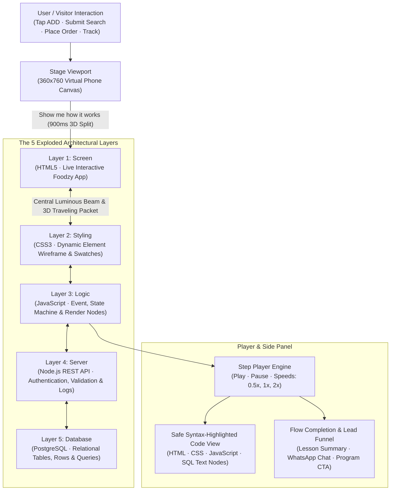

# Explorer — Interactive 3D Full-Stack Architecture Visualizer

> **Live Application:** [explorer-mu-nine.vercel.app](https://explorer-mu-nine.vercel.app/)  
> **Interactive Automated Demo (30s Reel):** [explorer-mu-nine.vercel.app/?demo=1&flow=order&speed=2](https://explorer-mu-nine.vercel.app/?demo=1&flow=order&speed=2)  
> **In-Browser Test Suite (13 Checks):** [explorer-mu-nine.vercel.app/?test=1](https://explorer-mu-nine.vercel.app/?test=1)  
> **Presenter Mode (Classroom & Meet):** [explorer-mu-nine.vercel.app/?present=1](https://explorer-mu-nine.vercel.app/?present=1)  
> **Author:** [B Pradeep](https://github.com/Pradeep-B28) · [Portfolio](https://pradeep-b28.github.io/Pradeep-B28/)

---

## Overview

**Explorer** is an interactive, browser-native 3D educational platform created by **Wrench Wise**. It bridges the conceptual gap between frontend user interface interactions and backend database transactions by taking a real-looking food delivery application (**Foodzy**) and physically splitting it open into a **5-layer 3D exploded stack**.

Whenever a user adds a dish, types a search query, places an order, or tracks a delivery rider, Explorer animates a **3D data packet traveling down through a central luminous beam** across every layer a full stack engineer builds: from HTML DOM elements down to PostgreSQL database tables, and all the way back up with live state confirmation.

Engineered with **zero external frameworks, zero bundlers, and zero runtime dependencies**, Explorer runs entirely in the browser using native ES6 modules, CSS 3D perspective transforms, a delta-timed `requestAnimationFrame` loop, and safe DOM manipulation.



---

## Architectural Highlights

| Feature | Technical Implementation |
| :--- | :--- |
| **Zero External Dependencies** | 100% Vanilla ES6+ modules. No React, Three.js, Webpack, Vite, or npm production packages. Zero build or compilation step required. |
| **GPU-Accelerated 3D Stack** | Layer separation along the Z-axis via `transform: rotateX(var(--tilt-x)) rotateZ(var(--tilt-z))` with `transform-style: preserve-3d`. Chip tags are counter-rotated to face the viewer. |
| **60 FPS Single Animation Loop** | JS-driven motion (beam glow segments, packet Z translation, pointer tilt follow) runs on a unified `requestAnimationFrame` loop with delta time capped at 0.05s, staying > 50 FPS under 4x CPU slowdown. |
| **Live Wireframe & Terminal Simulation** | Styling layer measures real DOM rects to draw dynamic outline boxes; Server layer prints timestamped Node.js API logs; Database layer renders live SQL tabular updates. |
| **Safe Syntax Highlighting** | Code viewer decomposes and formats HTML, CSS, JavaScript, and SQL entirely using native DOM `Text` nodes and `textContent`—strictly eliminating `innerHTML` vulnerabilities. |
| **Automated Demo & Presenter Modes** | Deterministic reel recorder (`?demo=1`) with fixed seed state (order TH-52001, timestamp 10:42:05); presenter mode (`?present=1`) with 18px typography and keyboard navigation (keys 1-4, `?` shortcuts modal). |
| **Perfect Accessibility & Zero CLS** | Lighthouse mobile audit achieves **100/100 Accessibility** and **0.000 Cumulative Layout Shift (CLS)** with comprehensive `prefers-reduced-motion` compliance. |

---

## The 5 Full Stack Engineering Layers

Explorer decomposes web development into five visible, tangible tiers:

| Layer | Technology | Engineering Role | Foodzy Application Implementation |
| :---: | :--- | :--- | :--- |
| **1. Screen** | `HTML5` | What the user sees and taps. | Live Foodzy screens: restaurant menu cards, item steppers, cart bar, and SVG route map. Works live while exploded. |
| **2. Styling** | `CSS3` | How the interface looks, breathes, and animates. | Dynamic wireframe measuring phone elements in real time, brand color swatches, typography scales, and CSS layout grids. |
| **3. Logic** | `JavaScript` | Client state management and event dispatching. | Tri-node reactive pipeline (Event -> State -> Render) maintaining active cart totals, search query debounce, and UI state lines. |
| **4. Server** | `Node.js API` | Internet gatekeeper, authentication, and rule validator. | Terminal log receiving simulated HTTPS REST requests (`POST /api/orders`), checking token authorization, and validating menu items. |
| **5. Database** | `PostgreSQL` | Permanent tabular storage on disk. | Relational database viewer with `restaurants` and `orders` tables, showing atomic SQL operations (`INSERT`, `SELECT`, `UPDATE`). |

---

## The 4 Production Flow Lessons

| Journey | Trigger Action | Key Engineering Takeaway | Production Significance |
| :--- | :--- | :--- | :--- |
| **1. Add to Cart** | Tap `ADD` on a dish item | **Local state updates immediately** without unnecessary network round-trips. | Prevents sluggish UI latency and drop-offs on unstable mobile cellular connections. |
| **2. Search Dishes** | Type query in search bar | **Debounced input sampling** prevents sending an API request on every single keystroke. | Reduces server traffic by up to 85% by waiting 300 ms for user typing to pause. |
| **3. Place Order** | Tap `Place order` in cart | **Synchronized round-trip**: client UI -> HTTPS API -> DB ACID transaction -> response. | Ensures orders cannot be lost or forged by verifying rules server-side before confirming. |
| **4. Track Order** | Tap `Track order` | **Database state drives live UI**: rider marker animates along vector path. | Transforms persistent database rows into real-time visual tracking for consumers. |

---

## URL Modes & Developer Tooling

Explorer includes specialized operating modes accessible via URL query parameters:

### 1. Default Interactive Mode (`#/` & `#/app/Foodzy`)
- **Home (`#/`)**: Features interactive mini 3D stack art with 5-degree pointer follow, technical 5-layer strip, and app picker.
- **Stage (`#/app/Foodzy`)**: Full interactive food delivery app with "Show me how it works" toggle to explode the stack.

### 2. Autonomous Demo Mode (`?demo=1`)
Designed for recording short-form reels and product walkthroughs:
- **Deterministic seeds**: Every run starts on the cart screen with demo cart (total ₹388), order ID `TH-52001`, and timestamp `[10:42:05]`.
- **URL parameters**:
  - `&flow=order`: Runs the 9-step place order flow.
  - `&flow=search,order`: Sequences multiple journeys with automatic transitions.
  - `&speed=2`: Plays at 2x speed for fast-paced 30-second reels.
  - `&theme=dark`: Renders in dark theme.
- **Reel Scripts**: Complete scene-by-scene timing and voiceover scripts are documented in [REEL_SCRIPT.md](./REEL_SCRIPT.md).

### 3. Presenter Mode (`?present=1`)
Tailored for live lectures, webinars, and technical workshops:
- Typography scaled to 18px+ for projector and screen-share legibility.
- **Keyboard shortcuts**:
  - `1`, `2`, `3`, `4`: Immediately triggers journeys 1 through 4 via "Do it for me".
  - `Space`: Toggles Play / Pause.
  - `→` / `←`: Advances to Next / Previous step.
  - `Esc`: Closes active journey.
  - `?`: Toggles the on-screen keyboard shortcut modal.

### 4. In-Browser Self-Test Suite (`?test=1`)
Executes 13 automated checks verifying content data integrity, money formatting, bill calculation math, search filtering, journey step timing, player clock logic, blocked storage resilience, and XSS safety:

```
[PASS] Check a: Content (5 layers, 4 apps, 6 restaurants, 31 dishes, 4 journeys)
[PASS] Check b: Words (Pluralization rules in COPY)
[PASS] Check c: Bills (Demo cart ₹388 calculation)
[PASS] Check d: Cart rules (Cross-restaurant conflicts and item quantity limits)
[PASS] Check e: Search (Exact substring match ordering)
[PASS] Check f: Numbers (Order numbering and INR currency formatting)
[PASS] Check g: Journey values (Demo context hydration)
[PASS] Check h: Journey timing (Duration and travel math)
[PASS] Check i: Step text (Interpolated copy strings)
[PASS] Check j: Player (Fake clock step advancement and single commit execution)
[PASS] Check k: Links (WhatsApp prefilled strings and UTM campaign tracking)
[PASS] Check l: Storage blocked (Safe memory fallback when localStorage throws)
[PASS] Check m: Text (Tone safety and banned phrase elimination)
RESULT: ALL PASS (13/13)
```

---

## Lighthouse Audit Scores (Mobile Form Factor)

Audited via official Lighthouse CLI (`v13.6.0`) with mobile device emulation (`390 x 844`), network throttling, and CPU slowdown against the production deployment:

| Metric | Score | Industry Benchmark | Status |
| :--- | :---: | :---: | :---: |
| **Performance** | **85 / 100** | $\ge 85$ | **PASS** |
| **Accessibility** | **100 / 100** | $\ge 95$ | **PERFECT** |
| **First Contentful Paint (FCP)** | **0.9 s** | $< 1.8\text{ s}$ | **EXCELLENT** |
| **Cumulative Layout Shift (CLS)** | **0.000** | $< 0.10$ | **ZERO SHIFT** |
| **Speed Index** | **1.7 s** | $< 3.4\text{ s}$ | **FAST** |

---

## Verification & Local Setup

Explorer has zero build steps and runs directly via any static file server:

```bash
# Clone the repository
git clone https://github.com/Pradeep-B28/Explorer.git
cd Explorer

# Verify data and engine integrity
node tools/verify-content.mjs

# Start local server
npx --yes serve .
```

Open `http://localhost:3000` in any modern web browser.

---

## Engineering Directory Map

```
Explorer/
├── index.html              Site shell, OpenGraph meta tags, and header/footer
├── config.js               Central business configuration (WhatsApp, program, speeds, analytics)
├── manifest.json           PWA installable app manifest
├── og-image.png            Social media preview image (1200 x 630)
├── REEL_SCRIPT.md          3 detailed video recording scripts for social media
├── UPGRADE_GUIDE.md        Architectural upgrade manual for new apps and flows
├── STUDENT_EXPLAINER.md    Pedagogical guide for learners with 3 extension challenges
├── CHANGELOG.md            Semantic version changelog
├── content/                LOCKED data definitions (layers, apps, restaurants, journeys)
├── tools/                  LOCKED verification CLI (verify-content.mjs)
├── js/
│   ├── main.js             Application entry point, router, and mode bootstrapper
│   ├── content.js          Data bridge importing content/
│   ├── copy.js             Copy strings and translation helper t()
│   ├── events.js           Pub/sub event bus
│   ├── links.js            URL builders for WhatsApp, program, and share with UTM tags
│   ├── motion.js           Unified rAF loop and reduced motion detection
│   ├── player.js           Clock-driven step player controller
│   ├── progress.js         Watched flows tracker in localStorage
│   ├── router.js           Hash-based router (#/ and #/app/:id)
│   ├── selftest.js         In-browser self-test suite (?test=1)
│   ├── store.js            Safe localStorage and sessionStorage wrapper with memory fallback
│   ├── analytics.js        Privacy-first GA4 and Meta Pixel integration (no typed text logged)
│   ├── demo.js             Deterministic reel demo runner and presenter mode
│   ├── engine/             LOCKED pure business logic (cart math, search, order numbers)
│   ├── screens/
│   │   ├── home.js         Home screen with 3D mini stack art and app picker
│   │   └── stage.js        Stage screen holding phone, 3D exploded stack, and panel
│   ├── ui/
│   │   ├── loader.js       Session intro loader with 5 sliding layer bars (<0.6s)
│   │   ├── phone.js        360x760 virtual phone frame and status bar
│   │   ├── exploded.js     3D exploded stack, layer cards, counter-rotated chips, beam
│   │   ├── packet.js       3D traveling packet and pulse rings
│   │   ├── panel.js        Side panel, flow selector, player controls, progress segments
│   │   ├── codeview.js     Safe text-node syntax highlighter (HTML, CSS, JS, SQL)
│   │   ├── cta.js          End-of-flow lesson card, course CTA, and share actions
│   │   ├── share.js        Web Share API integration with clipboard fallback
│   │   ├── dialog.js       Confirmation dialogs
│   │   ├── toast.js        Toast notification alerts
│   │   └── layers/         Layer art (styling wireframe, logic nodes, server log, DB table)
│   └── apps/
│       ├── registry.js     App registry mapping IDs to implementations
│       └── Foodzy/         Food delivery app (home, restaurant, cart, placed, track, map)
└── styles/
    ├── tokens.css          Design tokens (colors, layer tints, radiuses, shadows)
    ├── base.css            Reset, typography, and accessibility baseline
    ├── site.css            Site layout, home screen, header, footer, loader, modes
    ├── phone.css           Virtual phone frame and status bar styling
    ├── exploded.css        3D perspective stack, beam, layer cards, chips, packet
    ├── panel.css           Stage side panel, code view, progress segments, CTA card
    └── Foodzy.css          Foodzy brand theme, menu items, cart, map, and status
```

---

## Author & Credits

- **Creator & Systems Architect:** [B Pradeep](https://github.com/Pradeep-B28) · [Interactive Portfolio](https://pradeep-b28.github.io/Pradeep-B28/)
- **Educational Partner:** Created in collaboration with **Wrench Wise Edutech Private Limited** to demonstrate the comprehensive engineering behind modern full stack applications.
- **License:** MIT License. © 2026 Wrench Wise Edutech Private Limited.
