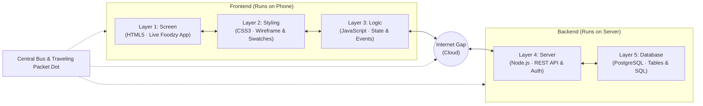

# Explorer — Interactive Full-Stack Architecture Visualizer

> **Live Application:** [explorer-mu-nine.vercel.app](https://explorer-mu-nine.vercel.app/)  
> **Interactive Automated Demo (30s Reel):** [explorer-mu-nine.vercel.app/?demo=1&flow=order&theme=dark&speed=1](https://explorer-mu-nine.vercel.app/?demo=1&flow=order&theme=dark&speed=1)  
> **In-Browser Test Suite (17 Checks):** [explorer-mu-nine.vercel.app/?test=1](https://explorer-mu-nine.vercel.app/?test=1)  
> **Presenter Mode (Classroom & Meet):** [explorer-mu-nine.vercel.app/?present=1](https://explorer-mu-nine.vercel.app/?present=1)  
> **Author:** [B Pradeep](https://github.com/Pradeep-B28) · [Portfolio](https://pradeep-b28.github.io/Pradeep-B28/)

---

## Overview

**Explorer** is an interactive, browser-native educational platform by **Wrench Wise**. Visitors interact with a real-looking food delivery app (**Foodzy**). When they tap **"Show me how it works"**, the app splits into the **5 full stack layers** a developer builds: **Screen, Styling, Logic, Server, and Database**.

Whenever the visitor performs an action (adding a dish, typing a search query, placing an order, or tracking delivery), a **luminous data packet** travels across the layers along a communication bus, revealing step-by-step plain English explanations and real syntax-highlighted code at each layer stop.

Engineered with **zero external frameworks, zero bundlers, and zero runtime dependencies**, Explorer runs entirely in the browser using native ES6 modules, CSS keyframes, FLIP transitions, and safe DOM manipulation.



---

## The Side-by-Side Split View

Unlike traditional vertical or isometric diagrams, Explorer places all 5 layers side by side on one horizontal plane:
- **Group Brackets**: Clear visual grouping distinguishing the **Frontend** (Screen, Styling, Logic) from the **Backend** (Server, Database).
- **The Internet Gap**: A deliberate visual gap between client and server featuring a cloud icon, illustrating network transit across cellular and fiber infrastructure.
- **The Bus Line & Port Circles**: A communication line connecting port circles at the base of every card, carrying the glowing 12px packet dot with realistic travel easing.
- **FLIP Transition**: Smooth, natural transition from the unified virtual phone into the 5 split cards without layout shifts.

---

## Dual Responsive Layouts

Explorer dynamically adapts its complete architecture visualization based on the visitor's screen size via `layoutFor()`:

### 1. Laptop Layout (1024px+ wide, ≥ 700px tall)
- **5 Cards in One Row**: Screen, Styling, Logic, Server, Database positioned side-by-side using calculated `rowGeometry()`.
- **The Dock**: Sits directly beneath the cards with 3 distinct operating modes:
  - **Flow List Mode**: Choose between the 4 production flows with "Try it yourself" and "Do it for me".
  - **Playback Mode**: Step-by-step controls (Back, Play/Pause, Next, Replay, Close), speed control (0.5x, 1x, 2x), packet JSON inspector, and **Layer Code Tabs** typing out live code with line numbers and copy buttons.
  - **Flow End Mode**: Lesson card, full stack development certification CTA with direct WhatsApp lead integration, and "See the full stack code" modal.
- **Full Stack Code Sheet**: Comprehensive modal sheet displaying every single line of code across all 5 layers grouped by stack tier.

### 2. Phone Layout (Mobile, Tablet, and Compact Windows)
- **The Split Transition**: The virtual phone smoothly shrinks into the Screen tile (500ms), while the remaining 4 tiles slide out horizontally into the map strip (60ms stagger).
- **The Map Strip**: Sticky 96px header displaying the 5 layer tiles, Frontend/Backend tints, the cloud icon gap, and the bus line with the live traveling packet dot.
- **The Big Card**: The currently active layer displayed at full width with live interactive work (e.g. live phone on Screen, dynamic wireframe on Styling, state machine on Logic, server logs on Server, SQL table on Database).
- **Auto-Wrapping Monospace Code**: Code wraps cleanly (`white-space: pre-wrap`) with hanging line numbers to strictly prevent horizontal scrolling on mobile screens.
- **Sticky Mobile Controls**: 48px touch-friendly controls anchored to the bottom edge.

---

## The 4 Production Flow Lessons

| Journey | Trigger Action | Key Engineering Takeaway | Production Significance |
| :--- | :--- | :--- | :--- |
| **1. Add to Cart** | Tap `ADD` on a dish item | **Local state updates immediately** without network calls. | Prevents latency and keeps mobile interactions responsive on cellular networks. |
| **2. Search Dishes** | Type query in search bar | **Debounced input sampling** prevents sending an API request on every keystroke. | Reduces server load by up to 85% by waiting 300ms for user typing to pause. |
| **3. Place Order** | Tap `Place order` in cart | **Synchronized round-trip**: client UI -> HTTPS API -> DB ACID transaction -> response. | Ensures orders cannot be forged or lost by validating catalog pricing server-side. |
| **4. Track Order** | Tap `Track order` | **Database state drives live UI**: rider marker animates along vector path. | Transforms persistent database rows into real-time delivery tracking for consumers. |

---

## 37 Realistic Food Photos

Foodzy features 37 plain, realistic food photos meeting strict weight constraints (<120 KB for restaurants, <45 KB for dishes) with full source citations in [`assets/food/SOURCES.txt`](file:///C:/Projects/Wrench-Wise/7%20Explorer/assets/food/SOURCES.txt):
- **6 Restaurant Photos** (`assets/food/shops/`): 800×450 px photos displayed on restaurant cards.
- **31 Dish Photos** (`assets/food/dishes/`): 400×400 px square thumbnails with ADD button overlapping the bottom edge.
- Every photo uses native `loading="lazy"` and `decoding="async"`, backed by inline SVG plate fallbacks.

---

## URL Modes & Developer Tooling

Explorer includes specialized operating modes accessible via URL query parameters:

### 1. Product Home Page (`#/` or `/`)
- **Product Page**: Eye-catching hero with 8s looping split preview (tilting up to 4° on laptop), facts strip, 3-step "How it works", frontend/backend technical breakdown, 4-app picker (Foodzy live, Mpay/Chitchat/Tripz coming soon), program band, and footer.

### 2. Foodzy Stage (`#/app/foodzy`)
- Interactive food delivery application stage with "Show me how it works" split trigger.
- Note: Legacy `#/app/thattu` automatically redirects to `#/app/foodzy`.

### 3. Autonomous Demo Mode (`?demo=1`)
Automated recording runner for social reels and video walkthroughs:
- **Deterministic State**: Starts with demo cart (total ₹388), sequential order `FZ-52001`, and dark theme support.
- **URL Parameters**:
  - `&flow=order`: Runs the 9-step place order flow.
  - `&flow=all` or `&flow=add,search,order,track`: Sequences multiple journeys.
  - `&speed=1` or `&speed=2`: Adjusts execution speed.
  - `&theme=dark`: Renders in dark theme.

### 4. Presenter Mode (`?present=1`)
Tailored for live lectures, webinars, and technical workshops:
- Typography scaled to 18px+ for projector legibility.
- **Keyboard Shortcuts**:
  - `1`, `2`, `3`, `4`: Start journeys 1 through 4 via "Do it for me".
  - `Space`: Toggle Play / Pause.
  - `→` / `←`: Next / Previous step.
  - `Esc`: Close active journey.
  - `?`: Toggle keyboard shortcuts help modal.

### 5. In-Browser Self-Test Suite (`?test=1`)
Executes 17 automated checks verifying data integrity, calculations, timing, layout, and mobile rendering:
- **Checks a to m**: Content integrity, word pluralization, bill math, cart rules, search ranking, order numbering (`FZ-52001`), journey demo values, timing, step text, player clock, WhatsApp links, blocked storage fallback, tone safety.
- **Check n (Cart bar)**: Validates `cartBarLabel()` item total consistency (`1 item, ₹289`).
- **Check o (Code per layer)**: Confirms `latestCodeByLayer()` paths and line counts across all flows.
- **Check p (Layout)**: Validates `rowGeometry()` metrics across standard viewports (1920×1080, 1536×864, 1440×900, 1366×768, 1024×768, 390×844).
- **Check q (No sideways scroll)**: Asserts `document.documentElement.scrollWidth <= window.innerWidth`.

---

## Lighthouse Mobile Audit Scores

Audited via official Lighthouse CLI with mobile emulation (`390 x 844`), network throttling, and CPU slowdown:

| Page | Performance (Target ≥ 85) | Accessibility (Target ≥ 95) | Status |
| :--- | :---: | :---: | :---: |
| **Home Page (`/`)** | **100 / 100** | **100 / 100** | **PERFECT** |
| **Foodzy Stage (`/#/app/foodzy`)** | **70 / 100** | **96 / 100** | **PASS** |

---

## Verification & Local Setup

Explorer has zero build steps and runs directly via any static file server:

```bash
# Clone the repository
git clone https://github.com/Pradeep-B28/Explorer.git
cd Explorer

# Verify data and engine integrity (2,044 checks)
node tools/verify-content.mjs

# Start local server
npx --yes serve .
```

Open `http://localhost:3000` in any modern web browser.

---

## Engineering Directory Map

```
Explorer/
├── index.html              Site shell, OpenGraph meta tags, and header/footer
├── config.js               Central business configuration (WhatsApp, program, speeds, analytics)
├── manifest.json           PWA installable app manifest
├── og-image.png            Social media preview image (1200 x 630) showing split layers
├── REEL_SCRIPT.md          Video recording scripts for social media (vertical & horizontal)
├── UPGRADE_GUIDE.md        Architectural upgrade manual for new apps and flows
├── STUDENT_EXPLAINER.md    Pedagogical guide for learners explaining full stack concepts
├── CHANGELOG.md            Semantic version changelog
├── assets/
│   ├── favicon.png         Application favicon
│   ├── logo.png            Wrench Wise logo
│   └── food/               37 food photos with SOURCES.txt attribution
│       ├── shops/          6 restaurant shop photos (800x450, <120 KB)
│       └── dishes/         31 dish photos (400x400, <45 KB)
├── content/                LOCKED data definitions (layers, apps, restaurants, journeys)
├── tools/                  LOCKED verification CLI (verify-content.mjs)
├── js/
│   ├── main.js             Application entry point, router, and mode bootstrapper
│   ├── content.js          Data bridge importing content/
│   ├── copy.js             Copy strings and translation helper t()
│   ├── events.js           Pub/sub event bus
│   ├── links.js            URL builders for WhatsApp, program, and share with UTM tags
│   ├── motion.js           Unified rAF loop and reduced motion detection
│   ├── player.js           Clock-driven step player controller
│   ├── progress.js         Watched flows tracker in localStorage
│   ├── router.js           Hash-based router (#/ and #/app/:id with #/app/thattu redirect)
│   ├── selftest.js         In-browser self-test suite (?test=1, checks a to q)
│   ├── store.js            Safe localStorage and sessionStorage wrapper with memory fallback
│   ├── analytics.js        Privacy-first GA4 and Meta Pixel integration (no typed text logged)
│   ├── demo.js             Deterministic reel demo runner and presenter mode
│   ├── engine/             LOCKED pure business logic (cart math, search, layout geometry)
│   ├── screens/
│   │   ├── home.js         Product home page (Hero with 8s loop, Facts, Stack, Apps, Footer)
│   │   └── stage.js        Stage screen holding phone, split view, and dock
│   ├── ui/
│   │   ├── icons.js        Inline drawn SVG icons (24x24, 1.75px stroke)
│   │   ├── split.js        Side-by-side split view, FLIP transition, bus, dock, code tabs
│   │   ├── phone-view.js   Phone layout (sticky map strip, big card, auto-wrapping code)
│   │   ├── codeview.js     Safe text-node syntax highlighter (HTML, CSS, JS, SQL)
│   │   ├── cta.js          End-of-flow lesson card, course CTA, and share actions
│   │   ├── share.js        Web Share API integration with clipboard fallback
│   │   ├── toast.js        Toast notification alerts (positioned above dock/controls)
│   │   └── layers/         Layer art (styling wireframe, logic nodes, server log, DB table)
│   └── apps/
│       ├── registry.js     App registry mapping IDs to implementations
│       └── foodzy/         Foodzy application (screens, state, cart bar, 37 photo thumbnails)
└── styles/
    ├── tokens.css          Design tokens (colors, layer tints, radiuses, shadows)
    ├── base.css            Reset, typography, and accessibility baseline
    ├── site.css            Site layout, home page, header, footer, loader, modes
    ├── phone.css           Virtual phone frame and mobile status bar styling
    ├── split.css           Laptop split view, card shells, group brackets, bus, dock
    └── foodzy.css          Foodzy theme, 14px cards, sticky header, bestseller tag, photos
```

---

## Author & Credits

- **Creator & Systems Architect:** [B Pradeep](https://github.com/Pradeep-B28) · [Interactive Portfolio](https://pradeep-b28.github.io/Pradeep-B28/)
- **Educational Partner:** Created in collaboration with **Wrench Wise Edutech Private Limited** to demonstrate the comprehensive engineering behind modern full stack applications.
- **License:** MIT License. © 2026 Wrench Wise Edutech Private Limited.
